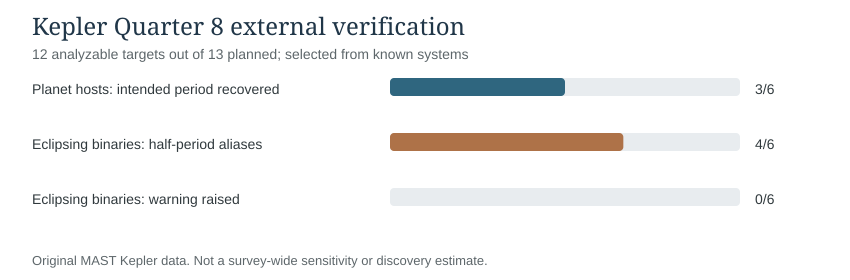
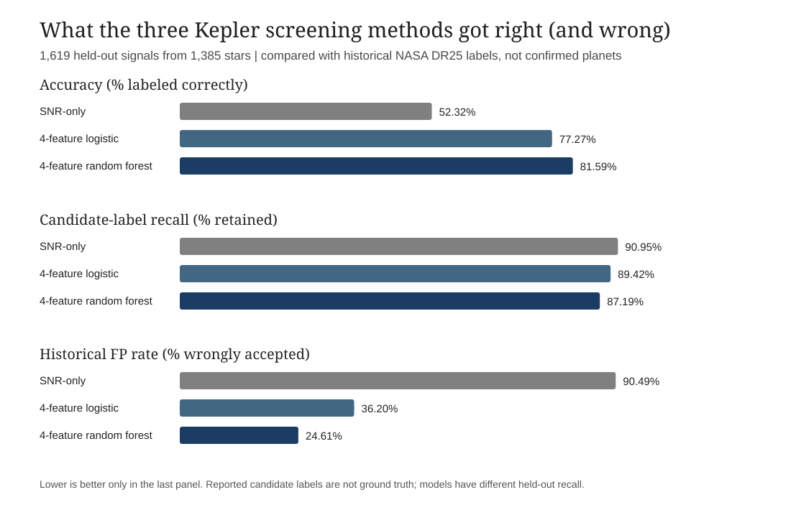
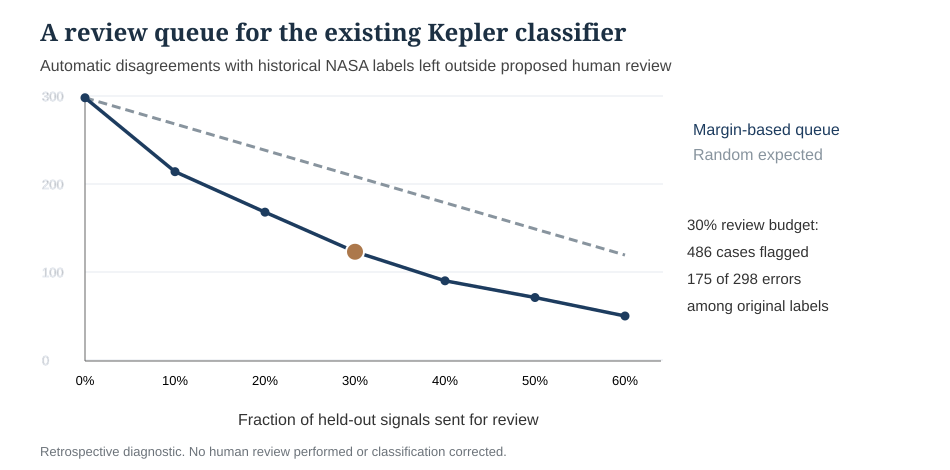
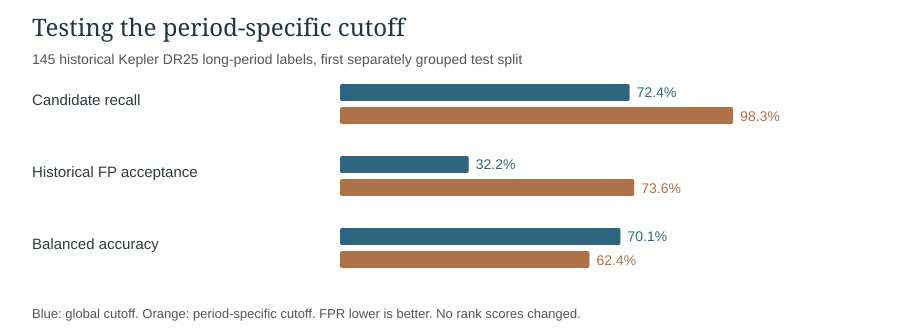
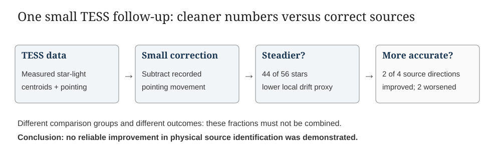

# Testing AI's Impact in Exoplanet Research
**Drew Thomas | ASTR/PHSC 12600 | Professor Buzasi | November 13, 2026**

The Kepler experiments below address the original November 5 proposal. The separate [technical research archive](ARCHIVE_LONGFORM_EXOMINER_TESS_TECHNICAL_DRAFT_BEFORE_PROPOSAL_ALIGNMENT.md) documents the additional TESS and ExoMiner investigations, which did not alter the Kepler classifier.

## The question I wanted to answer

Artificial intelligence is being presented as a tool that could change scientific research. It can write code, sort through large datasets, and find patterns that would take people a long time to identify. But I wanted to test something more specific: **can AI help someone without a professional astronomy background reproduce a real research method, and can it help improve the results?**

I chose exoplanets, which are planets orbiting stars outside our solar system. We have good reasons to believe that they are common, but most are far too distant and faint to see directly. Astronomers often have to work out whether a planet exists by studying small changes in the light they receive from a star. This connects directly to the class: we measure *flux* (the light reaching a detector), measure *time* between events, and use Kepler's laws to understand the motion that could cause those events.

I used generative AI to help write and debug Python code, and I used publicly available observations and catalog records from NASA's **Kepler** mission. The experiment had three parts. First, I tried to reproduce a familiar way of finding possible planets. Second, I tested whether a simple machine-learning model could better sort likely planets from false alarms. Third, after researching the limits of these techniques, I tried one smaller adjustment to a related telescope measurement to see whether cleaner data would actually produce a better scientific answer.

The first two parts are the **main Kepler experiment promised in my proposal**. The third is a separate exploratory follow-up using NASA's **TESS** telescope. It does not replace the Kepler analysis and was not added to the Kepler classifier.

### What my submitted proposal actually promised

My November 5 proposal asked whether AI could **replicate or improve established exoplanet identification techniques**. It specified NASA **Kepler** data, Python code for a traditional transit search, a **relatively simple machine-learning classifier**, and a quantitative comparison of **accuracy, false-positive rate, and candidate recovery** against simpler screening. It also promised clear disclosure of AI-generated work versus scientific interpretation. I have treated those commitments as a boundary: the real-data Kepler experiments below are the core deliverable, and the later TESS test is a modest, separately labeled extension. This paper reports what our programs did, not what a professional observatory ought to replace.

The distinction between **reproducing** and **improving** matters. Reproducing an established method means using actual measurements to recover a known, expected result. Improvement requires a fair comparison on the same task, with the cost of missed promising objects counted alongside the benefit of fewer false alarms. A cleaner-looking graph on its own does not establish either.

## 1. How does a telescope find a planet it cannot see?

Imagine watching the same star over and over. Most of the time, the amount of light reaching the telescope stays fairly steady. If a planet passes between us and the star, it blocks a small amount of that light for a short time. The amount of light drops, then returns to normal.

A single dip is not enough to prove that a planet is there. A telescope problem, a star changing in brightness, or an eclipse involving two stars can look similar. But if the dips repeat at a fairly regular interval, the pattern begins to look more like an orbit. The time between repeated dips is the *orbital period*.

This also explains why the observations are connected to physics rather than just pattern recognition. The size of the dip gives a rough clue about the planet's size relative to its star. The time between dips tells us how long the orbit takes. Kepler's third law connects that period to the size of the orbit, assuming we know something about the star's mass.

The basic challenge is **finding a very small repeating drop in a noisy set of brightness measurements**, while remembering that not every repeating drop is caused by a planet.

## 2. First experiment: can AI help reproduce a real planet-search method?

I asked generative AI to help implement **Box Least Squares**, or **BLS**, a standard technique astronomers use to search a light curve for a regular pattern of dips. A *light curve* is simply a graph of how a star's brightness changes over time.

BLS checks many possible orbital periods. At each one, it asks whether short, regularly spaced dimming events fit the observations better than a flat brightness level. The best-looking repeating pattern becomes a possible planet signal.

To see whether the the program was working, I tested it on real Kepler observations of a star already known to host a planet: **Kepler-69 b**. The planet was not discovered by this project. Using an original NASA Kepler Quarter 8 light-curve file, the program examined **2,767 usable brightness measurements** and found a repeating pattern.

The result was encouraging:

| Measurement | Result |
|---|---:|
| Previously published orbital period | **13.722 days** |
| Period found by our BLS program | **13.713 days** |
| Difference | **About 0.066%** |

The program also found five sufficiently observed dimming events within that telescope observation period. In simple terms, **AI helped me build code that could find the correct repeating pattern in real telescope data**.

### How this experiment actually worked, and the small checks added

The original method comes from **Kovács, Zucker and Mazeh (2002)**, *A box-fitting algorithm in the search for periodic transits*. Their idea was to compare a mostly flat brightness curve with a short, repeating box-shaped dip. This directly informed our use of Astropy's documented **Box Least Squares** implementation: we did **not** invent BLS, and the  program calls a validated numerical implementation rather than replacing the underlying mathematics.

We used Kepler target **KIC 8692861, Quarter 8**. The NASA MAST FITS file contained measured observation times, **PDC-SAP flux**, and data-quality flags. The Python script retained observations with `SAP_QUALITY == 0`, normalized the flux using a fixed **301-cadence running median**, and searched periods from **1.5 to 20 days**. The star was chosen because it already has a known planet; the *exact* published period was not used to select the numerical peak. The fitted **13.7133429855 days** compared with NASA's **13.7223682 days**:

```text
absolute difference = |13.7223682 - 13.7133429855| = 0.0090252 days
percentage difference = (0.0090252 / 13.7223682) x 100 = 0.06577%
```

These are period-error calculations, **not a 0.066% probability of being wrong** and not a measurement of how often the algorithm finds new planets. The fitted dip was approximately **529 parts per million (ppm)** and the fitted duration **0.153 day**. As an approximate physics check, the transit-depth relation `depth ≈ (planet radius / star radius)^2` implies a radius ratio of `sqrt(529/1,000,000) ≈ 0.023` for a simple uniform-brightness transit. It does not give the planet's absolute radius without additional stellar information and a more physical transit model.

After the first period fit, we added a basic **event-consistency check**, rather than trusting a single pooled plot: five adequately sampled dips had positive estimated depths, and the difference between the median odd- and even-event depths was about **24.6 ppm**. This is a useful safeguard against some misleading patterns, **not planet confirmation**. This check was motivated by professional Kepler vetting papers, which examine individual events and alternating eclipses.

One more small, clearly limited test used **real Kepler stellar noise plus injected *simulated* box-shaped transits**. We used Quarter 2 observations of KIC 2436365 after preprocessing and hid the injected periods from the BLS search. The fitted periods were within 2% of the injected periods in **1/3 trials at 500 ppm**, **3/3 at 1,500 ppm**, and **3/3 at 4,000 ppm**. This illustrates that weaker dips are harder to recover. Nine injections are far too few to measure population-wide detection efficiency, and they are **not nine newly observed exoplanets**.

**Original-data Figure 1:** [Open the archived genuine Kepler-69 b flux/time and folded-transit plot](https://github.com/DrewThomas09/ASTR_FInal_Project/actions/runs/42319839037/artifacts/13551514247). The upper panel shows actual normalized flux over time; the lower panel folds the same measurements on the period found by BLS, bringing repeated dips together. Source and processing summary: [real light-curve record](REAL_KEPLER_LIGHTCURVE_RESULTS_2026_11_06.md).

This is a successful reproduction of an established research technique, not a discovery of another planet. I deliberately chose a known planetary system to check whether the code behaved sensibly. That made it a useful first test, but it does not tell us how well the program would perform if we pointed it at thousands of unfamiliar stars.

*The original figure, downloaded from the successful real-data GitHub Actions run, is linked above and is included in the companion local evidence packet. It is **measured Kepler data**, not an AI-rendered illustration.*

### Rechecking the detector on more original Kepler light curves

A preselected external Quarter 8 test used **13 known Kepler targets** (six published planet-host targets and seven eclipsing binaries). Twelve had usable light curves; one missing target remained recorded. Among the six planet-host targets, the intended listed planet period was recovered for **three**. Four of six usable eclipsing binaries instead produced **half-period aliases**, and **none of six** triggered the unchanged simple binary-warning rule. The additional cases show why a close period match in the single Kepler-69 b test was a useful reproduction but not a general detection-rate measurement. [Complete original 13-target results](FROZEN_REAL_13STAR_VALIDATION_RESULTS.md).



If an eclipse period is incorrectly halved, Kepler's third law gives an inferred orbital radius factor of `(1/2)^(2/3) = 0.630` for fixed stellar mass, roughly **37% too small**. This is a direct error in a physical inference, not just a mislabeled graph.

After seeing two initial multi-planet mismatches, a separate *exploratory* iterative BLS run subtracted the first fitted box-shaped signal and searched the residual. In Kepler-20 it recovered the already-known **Kepler-20 c** period (~10.8578 days) first and the previously known **Kepler-20 b** period (~3.6963 days) on the second pass. Kepler-18 yielded matches to c and d but not the originally targeted b after three passes; Kepler-20's third peak was unmatched. The two systems were selected after observing initial failures, so these are development examples, not a new blinded detection-performance estimate. [Original iterative results](ITERATIVE_BLS_REAL_MULTIPLANET_RESULTS.md).


## 3. Second experiment: can machine learning tell better signals from false alarms?

Finding a repeating dip is only the beginning. There is another problem: **some very convincing-looking dips are not planets**. A pair of stars eclipsing one another, for example, can produce a clear repeating pattern. So I wanted to test whether machine learning could do a better job than a simple rule at separating signals NASA had previously marked as possible planets from signals NASA had marked as false positives.

For this experiment, I downloaded **8,054 records** from NASA's Kepler catalog, involving **6,923 different stars**. These records contain historical NASA screening labels: **4,034 'candidate' signals** and **4,020 'false positive' signals**. That distinction matters. A 'candidate' is a promising signal that may be a planet, **not necessarily a fully confirmed planet**.

I compared two approaches:

- **Simple rule:** Judge the signal mainly by how strong it is compared with the background noise. This is called the signal-to-noise ratio. It is an understandable first screen, but even a very strong signal can come from two stars eclipsing each other.
- **Machine-learning model:** Use a *random forest*, which looks for patterns across several measurements rather than relying on one cutoff. I gave it four pieces of information NASA already measured: the suspected orbital period, how long the dip lasts, how deep the dip is, and how strong the signal is relative to the noise.

The dataset was divided into **training, validation, and testing groups**. Most records were used to teach the model. A separate group was used to choose its decision cutoff. The final **1,619 records, from 1,385 stars**, were held back until evaluation. Stars in the test set did not also appear in the training or validation sets. That was important because the model should not get credit for already knowing the specific stars it was being tested on.

### What happened?

| On NASA's held-out Kepler records | Simple signal-strength rule | Random forest |
|---|---:|---:|
| Matched NASA's previous labels correctly | **52.3%** | **81.6%** |
| Historical false positives incorrectly called candidates | **695** | **189** |
| Historical candidates incorrectly rejected | **77** | **109** |

**The random forest was substantially better at reproducing NASA's previous screening labels overall.** Out of the same 768 historically labeled false positives in the test set, the machine-learning model incorrectly accepted only **189**, compared with **695** for the simple rule.

However, there was a trade-off. The random forest also rejected **32 more historical candidates** than the simpler rule. In astronomy, throwing away a promising signal matters, because one of those rejected candidates could turn out to be a real planet. The two methods were tuned on validation data to aim for a similar candidate-recovery rate, but their actual recovery rates on the held-out test set were different. It would be misleading to say the random forest was better at *everything*.

We also tested a more ordinary statistical model that used the same four measurements. It achieved **77.3%** overall label agreement. The random forest's **81.6%** result was better, suggesting that machine learning could pick up more complicated relationships than a simple statistical cutoff or a straight-line model. This was encouraging, but it was still a comparison to **historical NASA labels**, not a test against independently confirmed planet identities.

*The actual comparison graphic is now Figure 2 above; its values were taken from the saved original-data model predictions.*

### What the classification percentages actually mean

The test set had **851 historically candidate-labeled signals** and **768 historically false-positive-labeled signals**. The forest correctly retained **742** candidate labels and correctly rejected **579** false-positive labels. It incorrectly rejected **109** candidates and accepted **189** false positives. The one-variable SNR rule retained **774** candidate labels, correctly rejected only **73** false positives, incorrectly rejected **77** candidates, and accepted **695** false positives.

```text
Forest accuracy = (742 + 579) / 1,619 = 81.59%
SNR-rule accuracy = (774 + 73) / 1,619 = 52.32%

Forest candidate recall = 742 / 851 = 87.19%
SNR-rule candidate recall = 774 / 851 = 90.95%

Forest false-positive rate = 189 / 768 = 24.61%
SNR-rule false-positive rate = 695 / 768 = 90.49%
```

Here **false-positive rate** means the share of *NASA historically false-positive-labeled KOIs* our method incorrectly called candidates. It is **not** the probability that an accepted signal is actually a nonexistent planet, and **accuracy** is agreement with old screening labels, not agreement with independent astrophysical ground truth.



*Figure 2. A reproducible visualization of the original held-out NASA DR25 classification counts (N = 1,619), comparing signal-strength screening, four-feature logistic regression, and a four-feature random forest. For false-positive rate, lower is better; for the other two panels, higher is better. All cutoffs were selected on validation data, not on the test records.*

### A stronger baseline, and an important failure case

The **McCauliff et al. (2015)** Kepler random-forest paper showed why combining information from several transit diagnostics can be useful. Unlike their larger professional system, ours used only **four already measured catalog features**: period, duration, depth, and signal-to-noise ratio. To see if the forest was helping beyond a very weak one-variable comparison, we also tested a **four-feature logistic regression** model. It agreed with historical NASA labels **77.27%** of the time, compared with the forest's **81.59%**. The forest's balanced accuracy was **81.29%**, versus **76.61%** for logistic regression and **50.23%** for the SNR rule. A later host-star-resampled analysis estimated a forest-minus-logistic balanced-accuracy advantage of **4.68 percentage points** (approximate 95% interval **+2.28 to +6.92 points**), but this was a retrospective secondary comparison on an already explored data source.

We also took care **not to put signals from the same star on both sides of the train/test split**. A random row split could allow the model to recognize star-specific patterns it had already seen and make the result look better than it was. We used **4,824 training records, 1,611 validation records, and 1,619 test records**, with nonoverlapping host stars; missing values were imputed from the training set rather than using the test set. Thresholds were selected on validation stars with an intended **90% candidate-label recall**. Actual test recall was different across models, so this is **not** a same-recall comparison.

A revealing exploratory check focused on signals with periods of **at least 100 days**. Among **71 historically labeled candidates**, the forest retained only **44**, while logistic regression retained **66**. The forest screened out more historical false positives in that subgroup, but its lost candidate labels are a scientific limitation: a model may perform well on average while missing objects that are important to astronomers. We tested ten preselected group-split seeds; the forest's balanced-accuracy advantage stayed positive, but the test groups overlap and do **not** count as ten independent discoveries. These cautions follow the lesson of **Thompson et al. (2018)**: a scientific vetting pipeline must evaluate **completeness and reliability**, not accuracy alone.

The complete frozen prediction file and statistical analysis are retained in the [original paired-evaluation artifact](https://github.com/DrewThomas09/ASTR_FInal_Project/actions/runs/42513638366/artifacts/13630680897), with methods in [the verification report](VERIFIED_DR25_PAIRED_SIGNIFICANCE_2026_11_08.md).

### Added model audit: explaining a decision and prioritizing human review

The stronger, final-paper presentation includes the *actual* historical-label confusion matrices, ROC and precision-recall curves, and error rates by estimated orbital-period group. These all come from the same **1,619 original held-out Kepler signals**, not a generated example or a fresh independent test. The forest's continuous scores had **AUROC 0.8857** against NASA's historical dispositions, compared with **0.7803** for four-feature logistic regression and **0.3466** for the SNR-only score. The class labels here are the original DR25 Robovetter decisions, **not a list of physically confirmed planets**. The chosen operating threshold is a trade-off between accepting historical false positives and losing promising historical candidates.

The largest scientific weakness becomes clearer when performance is separated by period: among signals with estimated periods **100 days or longer**, the forest retained only **44/71 historical candidate labels (62.0%)** and wrongly accepted **16/69 historical false positives (23.2%)**. A logistic model with the same four features retained **66/71 candidate labels (93.0%)**, but wrongly accepted **58/69 false positives (84.1%)**. The forest is selective; it does not win every scientific objective. This is an exploratory subgroup analysis, not an independent validation of any new model.

As a modest **human-in-the-loop extension** of the *same frozen random forest*, I ranked review candidates by the distance between their score and the previously validation-selected decision threshold. This does not change classifier predictions, require an additional model fit, or pretend that reviewed cases were corrected. In the already-examined primary test set, the forest made **298** decisions disagreeing with historical NASA labels. Reviewing the **486 signals (30%)** closest to its decision threshold *would flag* **175** of these disagreements and leave **123** among the remaining 1,133. Random review of 486 would be expected to leave **208.5** disagreements unreviewed. These are retrospective **review-priority diagnostics**, not actual time savings, corrected discoveries or verified planet probabilities.



The analysis is reproducible from the saved [original held-out prediction CSV](https://github.com/DrewThomas09/ASTR_FInal_Project/actions/runs/42513638366/artifacts/13630680897) with [the supplemental score-review script](model_review_priority_analysis.py) and [full model extension record](NOV13_MODEL_EXPLANATION_REVIEW_PRIORITY_AND_CAUTION.md). The independent source data and fitted models were **not** modified. The official research-paper draft shared separately as DOCX/PDF includes more carefully formatted figures, the scientific formulas, full article bibliography, and the professor's classroom connections.

### A tested improvement attempt: period-specific cutoffs

The initial forest rejected many historical Kepler candidates with long periods. A separate saved test therefore tried **three validation-only cutoffs** for periods below 10 days, 10-100 days, and 100 days or longer, while leaving forest scores and input features unchanged. On **145 long-period signals** in the separately grouped first split, candidate recall increased from **42/58 (72.4%)** to **57/58 (98.3%)**, but incorrectly accepted historical false positives rose from **28/87 (32.2%)** to **64/87 (73.6%)**. Long-period balanced accuracy **decreased from 70.1% to 62.4%**. All ten overlapping grouped-star split runs showed worse overall balanced accuracy. This is a genuine tested, negative model result, not a proposal for an experiment that still needs to happen. [Validation policy, original source outputs, and limitations](VERIFIED_DR25_PERIOD_AWARE_THRESHOLD_NEGATIVE_2026_11_08.md).




## 4. After researching existing methods, what could we try to improve?

This was the part I found most interesting. By this point, I had shown that AI could help implement an existing search method and build a machine-learning model that performed better than a simple screen on the available labels.

But there was a limit to what those results meant. Our model was working with four numbers that astronomers had already calculated. It was not looking directly at every source of trouble in the original telescope measurements. Also, NASA's existing detection and validation systems were already far more advanced than the small model I had built. Trying to claim that my basic classifier outperformed professional planetary research would not make sense.

So instead of writing an entirely new detection method, I looked for **one specific measurement problem that was easy to explain and possible to test**.

A telescope is not perfectly still. Tiny changes in its pointing can change where a star's light lands on the detector. That movement can sometimes be confused with a real change in where the light is coming from. The *center of light* is important because it can help determine whether the dip comes from the target star or a nearby star.

Here is the simple idea we tested:

**What if we take the recorded movement of the telescope and subtract it from the measured movement of the star's light? Would that help make the measurement more trustworthy?**

This was a research-based, small adjustment to an existing measurement, not the only possible way to improve exoplanet research. I tested it as a **separate extension using NASA's TESS data**, because TESS provides both the measured center of light and an estimate of the telescope's pointing correction in its public records. These extra results are **not Kepler model scores**, and I did not feed the adjusted centroid into our Kepler random forest.

## 5. Third experiment: did the pointing adjustment help?

I used original observations from **56 TESS stars**. For each star, I compared the movement of the measured center of light before and after subtracting the recorded telescope pointing correction.

At first, the change looked promising: **44 of the 56 stars** showed a reduction in a simple local movement measure. In everyday language, the adjusted measurement was usually steadier.

But I then had to ask a harder question: **Does a steadier measurement actually tell us more accurately which star dimmed?**

Imagine two stars so close together that the telescope blends their light into one spot. If the star on the left gets dimmer, the combined center of light can shift toward the star on the right. That shift is **real information** about which star changed. An adjustment that merely makes every shift smaller could erase part of that information along with unwanted telescope movement.

I therefore tested the correction on **five additional stars** that had previously been flagged as possible nearby-eclipse cases. I chose those new stars before opening their centroid measurements. Four had enough complete repeated events for the planned comparison. In **two** systems, the adjusted shift pointed in a more physically plausible direction; in the **other two**, it got worse.

I also tried the same adjustment on a completely separate group of **five stars known to host transiting planets**, with **46 complete transit events**. All five showed a smaller measured in-transit centroid shift after correction. But that by itself does not prove an improvement, because some part of an in-transit shift may be real. In one of the five confirmed planetary systems, the correction actually made the local movement measure worse.

Finally, I compared two of the suspected neighboring-eclipse systems with genuine ground-based follow-up observations and NASA's own source-position reports. The ground observations supported fading light in nearby-star apertures. However, the simple TESS pixel images and NASA's fitted source positions were not consistent enough to assign the same dimming event confidently to one star across observations.

**The result was mixed.** The correction often made the measurement *look less noisy*, but our further checks **did not show that it reliably made the underlying planet-versus-false-positive decision better**.

This is an important distinction: **we measured a change in telescope data, not a verified increase in planetary classification accuracy**. The full, more technical experiments and all the disappointing cases are saved in [the NASA/TESS results scorecard](VERIFIED_NOV13_FULL_RESULTS_WHAT_WORKED_WHAT_FAILED_NASA_TESS_PRF_BENCHMARK.md); they do not need to take over this Kepler-focused paper.



*Figure 3. Diagram and measured counts for the independent TESS extension. The 44/56 result is a local motion-proxy reduction; the 2/4 result concerns directional plausibility in a different small source-frozen evaluation group. The outcomes answer different questions, so the fractions must not be pooled or presented as a single accuracy metric.*

## 6. The scientific articles that shaped the work

I found that the most useful papers were not necessarily the ones with the most complicated AI. Each solved a different problem and helped explain why our simpler program could work yet still fail.

**Kovács, Zucker and Mazeh (2002): why a repeating shallow dip can be found.** Their Box Least Squares method gave us the first testable piece of the proposal. The program searches trial periods and transit windows for a box-like loss of light rather than simply looking for large brightness changes. Their paper helped define the search method; our result tested an **implementation**, not a new theoretical discovery.

**McCauliff et al. (2015): why machine learning can help screen the detections.** They used random forests to classify Kepler transit-like signals from pipeline diagnostic measurements. They also discussed difficulty when a model sees longer-period signals unlike those in training. This motivated our four-feature forest and, after we saw the results, a close look at its **long-period candidate-recall problem**. Their published error rate was obtained on a different training population and label taxonomy; it must **not** be compared numerically as if it were our test-set score.

**Thompson et al. (2018): why classifying a candidate is not confirming a planet.** Their Kepler Data Release 25 Robovetter evaluated transit-event tests and used injected transits and false-alarm experiments to measure catalog completeness and reliability. We used the NASA DR25 catalog that came from this scientific process. This reading showed us why a machine learning program that matches those **previous decisions** is useful but does not independently establish planet identities. It also explains why reducing false alarms at the expense of lost candidates is a genuine trade-off.

**The Kepler team, *Pre-spectroscopic false-positive elimination* (2010): why the apparent center of light matters.** That work explains how alternating eclipse depths, possible secondary eclipses, centroid movement, and difference images reveal some blended eclipsing binary systems. The study helped motivate the narrower TESS pointing experiment. It also warned us that a centroid shift may contain **physical information** about which star actually dimmed. Subtracting motion might reduce noise or accidentally remove signal; the only meaningful test is whether source identification improves.

**Valizadegan et al. (2022), ExoMiner: what a more sophisticated system already does.** NASA's research combines several physically meaningful diagnostic views in a deep-learning classifier and reported validation of 301 planets. Reading it helped us see the limits of our four-number forest, particularly the absence of raw transit shapes and detailed source-location tests. We **did not** retrain ExoMiner, reproduce its complete neural network, or improve its published scores. ExoMiner informed our assessment of the existing field, not the headline experiment.

These readings changed the project's direction from a vague claim of 'better AI' to a series of **small, falsifiable comparisons**: identify an expected period; measure screening errors; and check whether one physical measurement correction improves the decision that matters. The supporting [paper-by-paper reading notes and source map](PROPOSAL_TO_RESULTS_RESEARCH_AND_CLASS_LINKS.md) identify which ideas we implemented and which stayed background.

## 7. What this taught me about the material from MEST

**Lesson 2: measurement of light, luminosity, flux and angular resolution.** In the lecture's *Luminosity and Flux* discussion (slides 40-41), luminosity is what a star emits; **flux** is what a detector receives per area, with `F = L/(4πd²)` for an isotropic source. In Kepler we study a **relative change in recorded flux**, not the star's total luminosity. The lecture's diffraction/resolution slides (49-50) also explain why light from nearby stars can blend in the telescope's detector. That is precisely why an apparent dip or centroid shift might originate from the wrong star.

**Lesson 3: measuring time accurately.** A planet's period is inferred from repeated dips with timestamps. A small timing error can change the estimated period and eventually where we predict the next event. The comparison of **13.7133** and **13.7224 days** is thus a measurement and calibration exercise as much as a coding result. The lesson covered historical clocks and the growing precision of time measurement; NASA's repeated brightness samples turn that idea into a modern astronomical measurement.

**Lessons 5-6: Newtonian gravity and Kepler's third law.** Kepler's third law relates the square of orbital period to the cube of orbital size. In Newtonian form, `P² = 4π² a³/[G(M_star + M_planet)]`; for a small planet mass, `a³ ≈ G M_star P²/(4π²)`. Our BLS program measures **P**, but does not independently measure **a** or stellar mass. This is why a period can be recovered from observed starlight without claiming to know all the planet's physical properties. These ideas appear in the opening Kepler-law slides of **Lesson 6**, which continue the orbital and gravitational discussion from Lesson 5.

**Lab 1 and Appendix B: precision, accuracy and uncertainty.** In the speed-of-light lab, we were taught to compare an experimental result to an accepted value, account for instrumentation and noise, and explain how averaging and calibration affect results. Here we similarly compare a fitted period with NASA's published value, and we distinguish **repeatable or smooth measurements** from **correct physical interpretation**. Appendix B, especially its *Accuracy vs. Precision* section (page 3), is directly relevant to our negative TESS result. A correction can reduce scatter (**precision**) without improving how often we identify the actual dimming source (**accuracy**).

The most meaningful connection to class is therefore not 'AI knows astronomy'. It is that **light, timing, dynamics and uncertainty must all be interpreted correctly before the numerical output becomes a scientific conclusion**.

## 8. Which small changes helped, which did not, and how they were tested

| Adjustment to the work | Why we tried it | What the original data show | What can honestly be concluded |
|---|---|---|---|
| Quality flags plus fixed running-median detrending on Kepler flux | Suppress clearly flagged measurements and long slow variations before BLS | Recovered Kepler-69 b's known period to 0.06577% in Q8 | A functioning known-target demonstration; **not** a separately measured improvement over a raw-flux baseline |
| Examine the five individual dips and odd/even depths | Check that one apparent event is not carrying the whole period fit | Five observed positive-depth events; 24.6 ppm difference of odd/even medians | Useful diagnostic, **not** confirmed planet validity |
| Inject simulated dips into a real observed-noise curve | Check whether signal depth makes recovery harder | Period recovered in 1/3 shallow versus 3/3 in each stronger group | Suggestive depth-sensitivity check; nine trials cannot establish survey completeness |
| Use four transit features in a forest instead of a single SNR cutoff | Let the model learn combinations of measurements | 81.6% vs 52.3% historical-label accuracy; lower labeled-FP acceptance, also lower candidate recall | Stronger **historical-label screening** under this test; no proof of better physical planet discovery |
| Split training and testing by star; tune thresholds on validation only; test logistic comparison | Prevent leakage and test if the extra complexity matters | Forest 81.29% balanced accuracy; logistic 76.61%; long-period candidate recall for forest only 44/71 | Better scientific evaluation, with a clear weakness to report |
| Subtract TESS recorded pointing correction from measured photocenter | Test one small physically motivated adjustment on a **separate** mission | Local movement proxy reduced for 44/56 stars; source direction improved in only 2/4 usable follow-ups | **Not shown** to improve physical source assignment |

The first five rows describe the Kepler work promised in the submitted proposal; the last is supplementary. We did **not** establish the causal effect of every preprocessing choice separately. The reproducible code, frozen input hashes and saved success/failure cases are in the linked experiment records.


## 9. Interpreting the computational results

Generative AI helped create and debug the Python routines for accessing NASA light curves and evaluating candidate signals. The results were obtained by running those programs on archived telescope observations and catalog records. Whether those results support an astronomical conclusion depends on the measurements and evaluation design, not on how quickly the code was produced.

At the same time, several apparent improvements did not hold up under closer checks. A stronger model missed more historically labeled candidates. A cleaner centroid signal was not necessarily better at identifying the source star. Some follow-up labels turned out to be less certain than they initially appeared, and some NASA source-position results were not valid measurements at all.

Those were moments when a human still had to ask basic scientific questions. Were we measuring the right thing? Were the comparison groups fair? Did a classification label mean a confirmed planet, or just a promising signal? Was a change in a graph evidence of better detection, or merely evidence that the code changed the numbers?

The Kepler analysis illustrates the difference between successful computation and physical confirmation. Recovering a known period and predicting historical screening labels were successful checks of specific methods, not independent planet discoveries.

## 10. Conclusion

I began with a straightforward question: **could AI help someone reproduce and possibly improve real exoplanet research methods?**

**On reproduction, the answer was yes.** The BLS code found the known Kepler-69 b orbital period to within **0.066%** using real NASA observations.

**On machine-learning screening, the result was also encouraging, with an important qualification.** Our small random forest matched NASA's historical Kepler candidate/false-positive labels **81.6%** of the time, compared with **52.3%** for a simple signal-strength rule. It rejected far fewer historically labeled false positives but also missed more candidates. This was not proof that it could confirm planets or outperform NASA's full professional pipeline.

**On improving a measurement, the answer was less clear.** The additional TESS pointing adjustment reduced a local movement measure in **44 of 56 stars**, but it did not consistently improve the information needed to decide which star produced a dip. Making data look more stable does not necessarily make the scientific answer more accurate.

The larger lesson is that AI can make sophisticated research techniques more accessible. It can help build tools and test ideas quickly. **But it cannot remove the need to understand the observations, choose fair comparisons, and check whether a numerical improvement answers the actual scientific question.**

## Original research records, articles and course references

**Original code, source measurements and reproducibility**

- [Kepler-69 b original real telescope light-curve BLS source and figure](https://github.com/DrewThomas09/ASTR_FInal_Project/actions/runs/42319839037/artifacts/13551514247).
- [Kepler DR25 original catalog holdout: model comparisons, predictions and charts](https://github.com/DrewThomas09/ASTR_FInal_Project/actions/runs/42513638366/artifacts/13630680897).
- [Kepler DR25 original-data findings](REAL_NASA_DR25_RESULTS_2026_11_06.md) and [statistical validation and known tradeoffs](VERIFIED_DR25_PAIRED_SIGNIFICANCE_2026_11_08.md).
- [TESS original-data extension: results that worked and results that failed](VERIFIED_NOV13_FULL_RESULTS_WHAT_WORKED_WHAT_FAILED_NASA_TESS_PRF_BENCHMARK.md).
- [Python source code and test suite](https://github.com/DrewThomas09/ASTR_FInal_Project).

**Scientific background**

- Kovács, Zucker and Mazeh (2002), the Box Least Squares transit search: https://doi.org/10.1051/0004-6361:20020802.
- McCauliff et al. (2015), machine learning in Kepler transit vetting: https://doi.org/10.1088/0004-637X/806/1/6.
- Thompson et al. (2018), Kepler DR25 automated planet-candidate vetting: https://doi.org/10.3847/1538-4365/aab4f9.

- NASA Exoplanet Archive, [Kepler-69 b system record](https://exoplanetarchive.ipac.caltech.edu/overview/Kepler-69) and [DR25 KOI column definitions](https://exoplanetarchive.ipac.caltech.edu/docs/API_kepcandidate_columns.html). The model uses `koi_pdisposition`, **not** a list of independently confirmed planets.
- Astropy, [Box Least Squares documentation](https://docs.astropy.org/en/stable/timeseries/bls.html); NASA/STScI [Kepler original light curves](https://archive.stsci.edu/missions-and-data/kepler).
- Kepler vetting team (2010), *Pre-spectroscopic false-positive elimination of Kepler planet candidates*: https://doi.org/10.1088/2041-8205/713/2/L103.
- Valizadegan et al. (2022), *ExoMiner: A Highly Accurate and Explainable Deep Learning Classifier That Validates 301 New Exoplanets*: https://doi.org/10.3847/1538-4357/ac4399. **Background comparison only; not reproduced here.**
- Course materials: **Lesson 2**, slides 40-41 and 49-50; **Lesson 3**, lecture on time; **Lessons 5-6**, Kepler's laws and gravity; **Lab 1**, speed-of-light measurement; **Appendix B**, page 3 on accuracy versus precision.


## Project elements checklist summary

| Lecture | Concept | Where used in this paper |
|---|---|---|
| Lesson 2: light and distance | Measured flux, inverse-square law, telescope resolution/blended sources | Sections 1, 2, 5, 7 |
| Lesson 3: time | Transit timing, inferred periods and reference comparison | Sections 1, 2, 7 |
| Lesson 6: Kepler's laws | Orbital period and Newtonian period-to-orbit relation | Sections 1, 2, 7 |
| Optional additional connection: Lab 1 / Appendix B | Accuracy, precision, quality of measurements, uncertainty | Sections 2, 5, 7 |

**Quantitative component:** original Kepler period comparison (13.7133429855 vs 13.7223682 days, 0.06577%); Kepler historical screening metrics from a star-held-out 1,619-signal test (accuracy, candidate recall, false-positive rate and stronger logistic baseline); small depth-injection sensitivity test; secondary TESS centroid test with explicit unsuccessful validation. **Locations:** Sections 2, 3, 5, 7 and 8 and Figures 1-3. The official professor-provided DOCX checklist should replace this drafting aid in the final exported submission.
