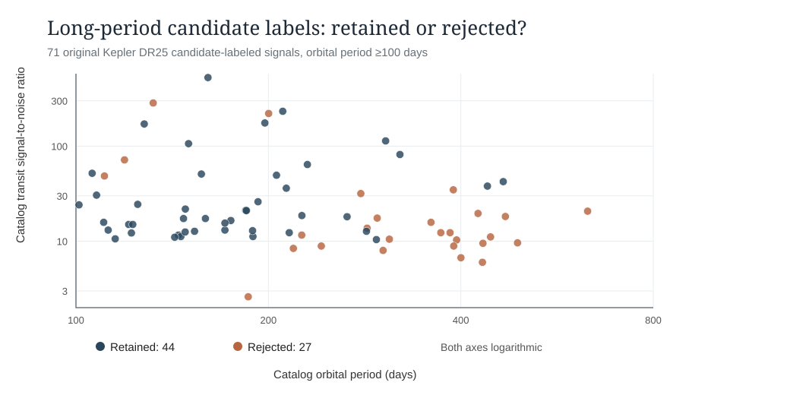
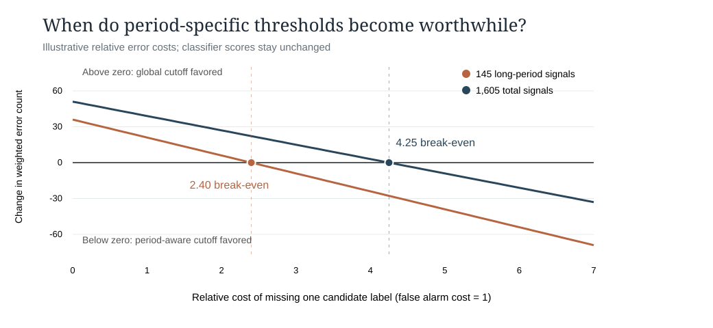

# Kepler DR25 long-period model errors and decision-cost audit

**November 13, 2026 | Proposal-aligned, retrospective analysis of two archived star-separated experiments**

## Why we examined this

The main Kepler random forest agreed with 81.59% of NASA's earlier screening decisions in the primary 1,619-signal holdout, yet retained only 44 of 71 `koi_pdisposition=CANDIDATE` objects with periods at least 100 days. A separate, previously frozen policy test changed three period-specific score cutoffs. It rescued some labeled candidates but raised false-positive acceptance and decreased balanced accuracy. This audit asks **which historical candidates are being rejected**, and whether a rational preference for candidate recovery could change the decision.

NASA defines [the source `koi_pdisposition` label](https://exoplanetarchive.ipac.caltech.edu/docs/API_kepcandidate_columns.html) as a pipeline vetting decision. These are not an independently measured set of true planets; `koi_duration` is given in hours, `koi_depth` in ppm and `koi_period` in days.

## Actual original-data calculations, no retraining

From the original 1,619 held-out records on 1,385 stars (SHA-256 `3682e0be30506ddcfe4bbb0c683ed6884454c5e5fbf8d946922fb48248712663`), the 71 `P >= 100`-day historical candidate labels split into **44 accepted** and **27 rejected** by the frozen random forest.

| Catalog feature | Retained 44 | Rejected 27 |
|---|---:|---:|
| Median orbital period (days) | **165.94** | **359.34** |
| Median transit signal/noise | **18.35** | **12.30** |
| Median transit depth (ppm) | **914.75** | **482.20** |
| Median duration (hours) | **9.52** | **12.37** |

These descriptive differences show the model tends to reject longer, shallower, less-significant historical candidate records in this selected group, **not** why any individual model split occurred. It does not establish actual exoplanet status or a causal explanation. Longer orbits provide fewer repeated events within an observing interval, but the forest consumes only four NASA-derived catalog summaries, not the raw light curves.

## Explicit trade-off in the earlier period-specific threshold experiment

The period policy and its host-separated train/validation/test splits were saved before that additional run. The **same forest scores** were used throughout; only thresholds changed. Its first separately seeded holdout had 145 long-period signals (58 historical candidates, 87 historical false positives).

| Long-period result | Original global cutoff | Period-specific cutoff |
|---|---:|---:|
| Historical candidate labels rejected | 16 | **1** |
| Historical false-positive labels accepted | **28** | 64 |
| Candidate-label recall | 72.41% | 98.28% |
| False-positive acceptance rate | **32.18%** | 73.56% |
| Balanced accuracy | **70.11%** | 62.36% |

The policy rescued **15** historical candidate labels but accepted **36** extra historical false positives. Across the first full **1,605-signal** split, it rescued **12** additional historical candidate labels while accepting **51** additional false positives. Overall balanced accuracy became worse, not better.

For an **illustrative** weighted-error objective, let one historically labeled false positive accepted for follow-up cost `1` unit and the dismissal of one historical candidate cost `r` units. Then:

- **Long-period group:** `L_period - L_global = 36 - 15r`, so period-aware selection has lower weighted error count only if **r > 2.40**.
- **Entire first split:** `L_period - L_global = 51 - 12r`, so the corresponding crossover is **r > 4.25**.

These units do not represent measured telescope time, money or probabilities of confirmed exoplanets. This is a retrospective decision interpretation, not a new prespecified performance metric. It neither fixes the forest's class ranking nor establishes an improvement in the ROC AUC.

## Reproducibility

- Primary frozen historical-label predictions: [original DR25 source artifact](https://github.com/DrewThomas09/ASTR_FInal_Project/actions/runs/42513638366/artifacts/13630680897), SHA-256 `3682e0be30506ddcfe4bbb0c683ed6884454c5e5fbf8d946922fb48248712663`.
- Separately evaluated period-policy predictions: [frozen comparison artifact](https://github.com/DrewThomas09/ASTR_FInal_Project/actions/runs/42514013228/artifacts/13630652118), SHA-256 `2c91a6a3cd403b42954537c69439903d9117ba7feed09539ae7e5868863a68c0`.
- Underlying code: [the original random forest](ml_screening.py) and [period threshold experiment](dr25_period_aware_recall_experiment.py).
- Source methodology: [paired inference and subgroup report](VERIFIED_DR25_PAIRED_SIGNIFICANCE_2026_11_08.md) and [negative period-aware validation report](VERIFIED_DR25_PERIOD_AWARE_THRESHOLD_NEGATIVE_2026_11_08.md).
- Main interpretation in the course [final report](FINAL_REPORT_OPENING_HISTORY_FLUX_EXOMINER_AND_AI_REPLICATION_DRAFT.md), with additional full-sized research graphics in the formatted paper.

**Connection to MEST:** Lesson 2 concerns measured stellar flux; Lesson 3 explains repeat timing; Lessons 5-6 relate orbital period to gravity and orbit scale; the laboratory discussion of uncertainty explains why an apparently better metric must be judged against its physical purpose.
