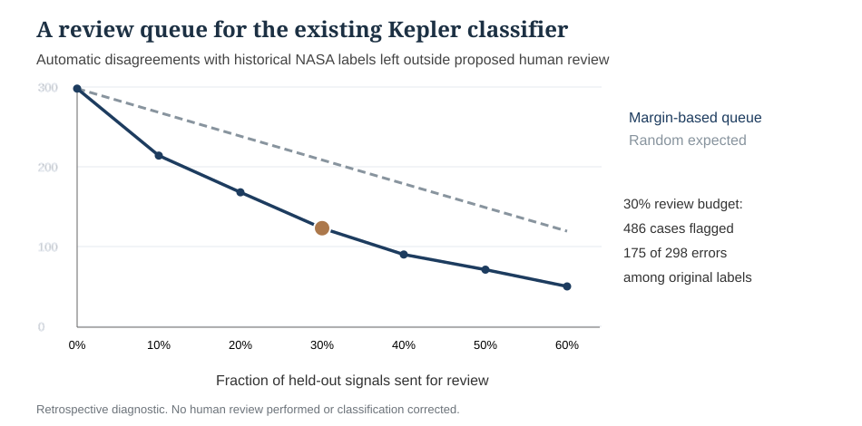

# Additional model audit and review-priority extension (November 13, 2026)

## Strict boundary of the submitted proposal
The November 5 proposal requires **Kepler** data, AI-assisted Box Least Squares code, a simple ML screening classifier, comparison against a simpler rule, and explanation of what scientific interpretation required. This addendum keeps the original models frozen. The separate TESS centroid subtraction is supplementary and did not feed the Kepler classifier.

## Added scientific value
The existing four-feature forest agreed with **81.59%** of the earlier NASA DR25 candidate/false-positive labels on **1,619 held-out signals from 1,385 stars**. The SNR-only threshold agreed with **52.32%**; logistic regression using the same four catalog inputs agreed with **77.27%**. Those are **previous vetter labels**, not independently confirmed planets. False-positive rates were **24.61%**, **90.49%**, and **36.20%** respectively for forest, SNR, logistic. The forest's candidate recall (**87.19%**) was below SNR (**90.95%**) and logistic (**89.42%**).

The extra model explanation now covers:
1. **Four inputs:** period, transit duration, depth, and signal-to-noise ratio; their astronomical meaning; log1p transformation; imputation based only on training stars.
2. **Fair splitting:** 4,824 training, 1,611 validation, 1,619 test *signals*, with no host-star identity overlap between subsets.
3. **What the forest means:** 120 trees, maximum depth 9, minimum 3 samples per leaf; it learns interactions in the four NASA summary measurements. It does **not** inspect raw pixel positions or discover planets directly from the KOI table.
4. **Metrics and failure cases:** historical-label confusion matrices and ROC/PR curves, including continuous AUROC values 0.8857 (forest), 0.7803 (logistic) and 0.3466 (SNR).
5. **Long-period limitation:** for periods >=100 days, the forest kept **44 of 71** candidate labels and admitted **16 of 69** false-positive labels, whereas logistic kept **66 of 71** and admitted **58 of 69**. The goals trade off.
6. **Practical review extension:** at a 30% human-review budget (486 signals), the forest's validation-fixed score-margin ranking flagged **175 of its 298 historical label disagreements**, leaving **123** unreviewed compared with about **209** expected under random review. The model's predictions are **unchanged**. The review is **not actually performed**, so no corrected labels or researcher time savings are claimed.

## Reproducing the numbers
Download [original NASA DR25 paired model outputs](https://github.com/DrewThomas09/ASTR_FInal_Project/actions/runs/42513638366/artifacts/13630680897), extract `primary_heldout_paired_predictions.csv`, and run:

```bash
python model_review_priority_analysis.py primary_heldout_paired_predictions.csv
```

The analysis uses those **already explored** held-out records; it is **descriptive/retrospective**, not another independently blinded experiment or a new model training run. Original archive SHA and model methods are in [the verified statistics report](VERIFIED_DR25_PAIRED_SIGNIFICANCE_2026_11_08.md).



## Physics and paper connections
- Kovács, Zucker & Mazeh (2002), [BLS](https://doi.org/10.1051/0004-6361:20020802): find repeating box-shaped transit patterns in measured flux.
- McCauliff et al. (2015), [Kepler random forests](https://doi.org/10.1088/0004-637X/806/1/6): combine independent transit diagnostics; longer periods may present changing model populations.
- Thompson et al. (2018), [Kepler DR25 Robovetter](https://doi.org/10.3847/1538-4365/aab4f9): why completeness, false alarms and reliability must be evaluated separately; archived candidate labels are not physical confirmation.
- Batalha et al. (2010), [Kepler false-positive checks](https://doi.org/10.1088/2041-8205/713/2/L103): odd/even dips, secondary eclipses, centroid and difference-image vetting.

**MEST lecture synthesis:** Lesson 2 (received flux, resolution and contamination), Lesson 3 (timing), Lessons 5-6 (Kepler's laws and period), Lab 1 and Appendix B (measurement error and the difference between precise and accurate inference).

**Disclosure:** The computational analysis, figures and writing were substantially AI-assisted; all scientific claims are subject to student's review and validation before a course submission.
