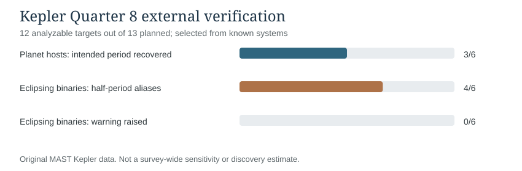
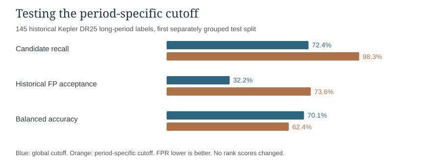

# Additional Kepler validation: external stars, iterative BLS, and a tested negative threshold result

**ASTR 12600 | November 13, 2026 | Original recorded Kepler results**

## Relation to the submitted November 5 proposal

The project asks whether generative AI can help reproduce and improve established exoplanet detection methods using Kepler photometry and a modest machine-learning candidate screen. The external light-curve and threshold studies test the limitations of those same two promised methods. They do not change the proposal into an ExoMiner project or claim a new planet discovery.

## 1. Does BLS generalize beyond a known successful planet?

Our first known-target Kepler-69 b Quarter 8 experiment returned 13.71334299 days versus the published 13.7223682 days, an error of 0.06577%. To check whether this apparent success generalized, a separate **13-target external Kepler Quarter 8 sample was frozen before evaluating those light curves**. It included 6 published planet-host targets and 7 published eclipsing binaries. All used original NASA MAST long-cadence PDC-SAP flux, quality-flag filtering, a 301-cadence running-median correction, and one fixed BLS search of 0.9 to 15 days.

**One binary lacked usable Quarter 8 observations and remains in the denominator of 13 planned targets.** Twelve were analyzed. The targets were deliberately selected by published identity, not randomly sampled from all stars.

| Exact question | Recorded result | Interpretation |
|---|---:|---|
| Planet-host targets analyzed | 6 of 6 planned | Preselected, known hosts |
| Intended planet's published period recovered to within 2% | **3 / 6** | One successful target cannot establish broad period recovery |
| Binary targets analyzed | 6 of 7 planned | One unusable observation retained as missing |
| Binaries with BLS peak near **half** the published stellar period | **4 / 6** | Primary and secondary eclipses can create a misleading period alias |
| Known binaries triggering the unchanged binary-review rule | **0 / 6** | The simple physical warning failed on this selected follow-up group |

The two apparently unmatched planet-host cases Kepler-18 b and Kepler-20 b were traced to periods close to **other previously confirmed planets in the same systems**, not necessarily to pure noise. Kepler-21 b's fitted peak remained unmatched. The known binary cases show why finding a regularly recurring dip and correctly identifying a planet are different problems.

**Physics connection to Lessons 5 and 6.** If the true binary orbital period is P but the algorithm selects P/2, Kepler's third law gives **a_fitted / a_true = (P_fitted / P_true)^(2/3) = (1/2)^(2/3) ≈ 0.630**, assuming the same system mass. A half-period alias would therefore produce an approximately **37% underestimate of orbital size**, even before the more basic physical mistake of identifying a stellar eclipse as a planet transit.

### Small follow-up: searching again after the strongest signal

After viewing these failures, the code was modified to subtract the strongest fitted box-dip model and run BLS again, up to three passes, on the **same original Q8 photometry**. On Kepler-20, it first matched the published **Kepler-20 c** period (10.8578 days) and then found **Kepler-20 b** (3.6963 days) on the second pass. On Kepler-18, it recovered known c and d periods in the first two passes but **not Kepler-18 b** in any of three passes. One third-pass Kepler-20 peak was unmatched. These stars were deliberately selected **after** the preceding errors were seen; the second-pass successes are development examples, not independent validation of better detection efficiency.

Original source and results: [Frozen 13-star external validation](FROZEN_REAL_13STAR_VALIDATION_RESULTS.md), [iterative BLS recorded outcomes](ITERATIVE_BLS_REAL_MULTIPLANET_RESULTS.md), [real external source code](real_external_cohort.py), [iterative source code](iterative_bls.py).

- [Original external cohort artifact (run 42321227884)](https://github.com/DrewThomas09/ASTR_FInal_Project/actions/runs/42321227884/artifacts/13552807831): CSV of all 13 attempted targets, FITS hashes, frozen sample, and plot.
- [Original sequential BLS artifact (run 42321423938)](https://github.com/DrewThomas09/ASTR_FInal_Project/actions/runs/42321423938/artifacts/13552579561): both stars' pass-level results and actual residual-light-curve figures.

## 2. Did period-specific forest thresholds improve long-period planet-candidate screening?

The first machine-learning experiment trained a four-feature random forest on NASA's historical Kepler DR25 **CANDIDATE / FALSE POSITIVE vetting labels**, with host-star-separated training, validation and testing. Its primary 1,619-signal test had **81.59% overall historical-label agreement**, compared with **77.27%** for four-feature logistic regression and **52.32%** for SNR-only screening. That first primary split is separate from the extra experiment below.

The forest had rejected many historical candidate labels with periods at least 100 days, which motivated a modest modification: **use the same forest scores but choose a different decision cutoff inside each of three period groups**. Cutoffs were selected using only validation stars, aiming for 90% historical-candidate recall within each bin; a small bin would fall back to the global cutoff. The method, three bins, new host-group split seeds 14000-14009, and primary endpoint were saved before evaluating the new test split.

On the first new split, **145 long-period signals** (58 historical candidates and 87 historical false positives) gave:

| Long-period historical-label result | Single global cutoff | Period-specific cutoffs |
|---|---:|---:|
| Candidates retained | 42/58 | **57/58** |
| Candidate recall | 72.41% | **98.28%** |
| Historical false positives accepted | **28/87** | 64/87 |
| False-positive acceptance rate | **32.18%** | 73.56% |
| Balanced accuracy | **70.11%** | 62.36% |

The change retained **15 additional historical candidates**, but also accepted **36 additional historical false positives**. It **decreased long-period balanced accuracy by 7.76 percentage points**. On the complete **1,605-signal first new holdout**, overall balanced accuracy fell from 78.96% to 76.58% (minus 2.38 points). Across **ten preselected, partially overlapping grouped-star splits**, the new cutoff rule reduced overall balanced accuracy **in all ten**. They are not ten independent observational cohorts. For the specified first split, the host-level paired test for long-period balanced-accuracy difference gave p = 0.1336 and a bootstrap interval spanning zero.

**Interpretation.** The cutoff change was an actual tested modification, but it did **not** improve the primary metric. Retaining more candidates while accepting more false positives is a different operating point, not better underlying discrimination. The model's **ROC AUC is unchanged**, because the continuous scores and the ranking of objects were never altered. An additional gain would need independent physical diagnostics rather than only more favorable thresholds.

Original code and evidence: [frozen period-bin policy](PERIOD_AWARE_DR25_VALIDATION_FROZEN_2026_11_08.json), [results and uncertainty assessment](VERIFIED_DR25_PERIOD_AWARE_THRESHOLD_NEGATIVE_2026_11_08.md), [source](dr25_period_aware_recall_experiment.py), [original predictions and ten-split outcomes](https://github.com/DrewThomas09/ASTR_FInal_Project/actions/runs/42514013228/artifacts/13630652118).

## 3. What this adds to the submitted research

The experiments now show **successful reproduction**, a quantitative candidate-screening improvement over a weak baseline with an explicit cost in missed candidates, and two independent kinds of limits:

1. The Kepler first-pass search succeeds on some planets but misses others, selects different already-known planets in multi-planet stars, and can give half-period aliases for stellar eclipses.
2. A threshold adjustment designed to recover long-period candidate labels did work on recall, yet worsened overall balanced accuracy; improving one number did not improve the stated model objective.

These limits make the existing TESS follow-up easier to interpret: a cleaner-looking centroid metric does not establish a more accurate source assignment. The central Kepler analysis remains the focus, just as the proposal specified.

Scientific background: [Kovács et al. (2002), BLS](https://doi.org/10.1051/0004-6361:20020802), [McCauliff et al. (2015), Kepler random forests](https://doi.org/10.1088/0004-637X/806/1/6), [Thompson et al. (2018), NASA DR25 Robovetter](https://doi.org/10.3847/1538-4365/aab4f9). The connection to MEST involves received flux and resolution (Lesson 2), accurate event timing (Lesson 3), orbit period and Kepler's law (Lessons 5-6), and the difference between precision and accuracy (Lab 1 and Appendix B).

**Original CSV verification:** `all_attempted_targets.csv` SHA-256 `a5d6029283325b1f119db771aa5eb8a6be28ea5a35f2a3aa009a088133abea30`; `all_iterations.csv` SHA-256 `fa7f909a3240369da3ecbed6cf36469c2e01cc53e0f4abe9a1d79a7a62de5832`; `first_new_split_paired_predictions.csv` SHA-256 `2c91a6a3cd403b42954537c69439903d9117ba7feed09539ae7e5868863a68c0`.
