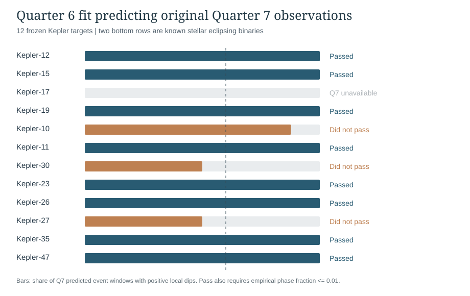

# Frozen Quarter 6 to Quarter 7 validation, and deep-signal classification results
ASTR/PHSC 12600 | Original NASA Kepler data | Verified November 13, 2026

## Relationship to the submitted November 5 proposal
The submitted project asked whether generative AI could help reproduce and possibly improve established exoplanet detection techniques. The core experiments remain Kepler transit photometry and a small classifier for earlier NASA Kepler screening decisions. The following results add a stronger, temporally separated check of the transit-search program, and a physical explanation of why a strong detected signal does not automatically identify a planet. The separate TESS pointing subtraction remains supplementary.

## Independent-quarter validation: actual completed research

The frozen [November 8 experimental manifest](Q6_TO_Q7_BLIND_PREDICTIVE_VALIDATION_FROZEN_2026_11_08.json) fixed the targets and test rule before the independent-quarter run. [Original code](q6_to_q7_blind_ephemeris_validation.py) fitted BLS period, event epoch and duration from **NASA Kepler Quarter 6 only**. Quarter 7 original PDC-SAP measurements were subsequently examined, but neither period nor phase was adjusted. Results and the original output are in the **successful November 13 GitHub Actions [run 43512648584](https://github.com/DrewThomas09/ASTR_FInal_Project/actions/runs/43512648584)**, [artifact 14079785749](https://github.com/DrewThomas09/ASTR_FInal_Project/actions/runs/43512648584/artifacts/14079785749).

The frozen rule called a source positive only if there were **at least two adequately observed predicted Quarter 7 event windows**, the mean local depth exceeded **at least 99% of 1,000 within-star alternative phase shifts** (empirical one-sided fraction <= 0.01), and **at least 60%** of the predicted windows had a positive locally measured dip. The phase comparison tests contrast against other phases of the **same light curve**. It is not a calibrated Kepler mission-wide false alarm probability. It does not identify which body causes a transit.

| Prespecified target | Published source role | Q6 fit (days) | Q7 usable events | Positive local Q7 dips | Empirical phase fraction | Frozen result |
|---|---|---:|---:|---:|---:|---|
| Kepler-12 | Known planet host | 4.438352 | 20 | 20/20 | 0.000999 | Pass |
| Kepler-15 | Known planet host | 4.944662 | 17 | 17/17 | 0.000999 | Pass |
| Kepler-17 | Known planet host | n/a | n/a | n/a | n/a | Unavailable Q7 |
| Kepler-19 | Known planet host | 9.285511 | 9 | 9/9 | 0.000999 | Pass |
| Kepler-10 | Known planet host | 1.675711 | 49 | 43/49 | 0.057942 | Does not pass |
| Kepler-11 | Known planet host | 13.025170 | 5 | 5/5 | 0.000999 | Pass |
| Kepler-30 | Known planet host | 15.077260 | 6 | 3/6 | 0.000999 | Does not pass |
| Kepler-23 | Known planet host | 10.740651 | 8 | 8/8 | 0.000999 | Pass |
| Kepler-26 | Known planet host | 12.280289 | 7 | 7/7 | 0.000999 | Pass |
| Kepler-27 | Known planet host | 14.954862 | 6 | 3/6 | 0.605395 | Does not pass |
| Kepler-35 | Previously examined stellar binary | 10.371079 | 8 | 8/8 | 0.000999 | Pass |
| Kepler-47 | Previously examined stellar binary | 7.449822 | 10 | 10/10 | 0.000999 | Pass |

**Six of ten** planned planet-host stars passed (six of nine with usable observations). Kepler-17 had no available Quarter 7 FITS and was **not substituted**. **Both two stellar binaries also passed.** There were **145 usable forecast-centered event windows** across 11 analyzed stars and **11,000 original alternative phase comparisons**, 1,000 per usable star. The original archive contains the full source SHA256 hashes and failures.

For Kepler-12, the BLS period found in Quarter 6 was 4.438352 days, and **all twenty Quarter 7 predicted event windows** contained a positive measured local dip (mean 1.5639%). The original held-out flux plot is in the successful workflow artifact, with Q6 and **unrefitted Q7** measurements folded using the **same Q6 fit**. This is stronger than comparing two separately reoptimized quarters.

### What did not work and why it matters
Kepler-10 failed despite 43 of 49 Q7 windows showing positive dips, because its observed mean depth was not unusually large relative to the alternative phase comparison (empirical fraction 0.057942). Kepler-30 had a low phase fraction but failed the independently frozen 60%-positive-event test (3/6). Kepler-27 failed both (3/6 positive and fraction 0.605395). Outcomes depend on both criteria; we did not revise those rules after seeing these failures.

Passing Kepler-35 and Kepler-47 demonstrates that a predicted *periodic dimming* is not a planet confirmation. A binary star can be a very consistent physical source of repeating eclipses. These planet hosts were identified in advance from already published catalog systems, so the result is **neither a new-planet discovery nor an unbiased survey completeness estimate**.

## Strong observed dips versus physical interpretation
A separate analysis of the **original 1,619 frozen NASA DR25 Kepler Object of Interest predictions** tested why the forest rejected many strong events. Of 391 held-out KOIs with reported transit SNR >=100, NASA's earlier Robovetter had labeled **312 historical FALSE POSITIVE** and **79 historical CANDIDATE**. The frozen forest correctly rejected 291 of the 312 historical false positives, but also dismissed 24 of the 79 historical candidates, retaining 55 and accepting 21 historical false positives.

Within these same 391 high-SNR catalog records, 260 showed reported depth >=10,000 parts per million (a 1% dip). Only 22/260 (8.46%) had NASA's earlier candidate label, versus 57/131 (43.51%) for high-SNR dips below 1%. The retrospective **35.05 percentage-point** difference had an approximate **2,500 whole-host-star bootstrap 95% interval of 25.58-44.35 points**, computed from the frozen scores and known labels. This association is consistent with stronger eclipsing binaries being among many historically rejected deep transits; it does **not** prove the physical identity of every labeled record. Some genuine giant planets have dips deeper than 1%, so depth must not be treated as a veto.

Source: [frozen original 1,619-row model predictions](https://github.com/DrewThomas09/ASTR_FInal_Project/actions/runs/42513638366/artifacts/13630680897), original prediction CSV SHA256 3682e0be30506ddcfe4bbb0c683ed6884454c5e5fb8d946922fb48248712663. The new observational and label-analysis script is [verify_q6_to_q7_and_dr25_v9.py](verify_q6_to_q7_and_dr25_v9.py).

## Reproducing, class connections and scope
The unmodified successful forecasting ZIP has SHA256 **9eb71ebf72014a8392949923d95e2c9b3cc633047809e10bd0f67229dc558dac**. The combined standalone reproduction package is supplied with the formatted 25-page final paper. It reruns assertions for the frozen protocol, all 145 event rows, every one of the 11,000 phase comparators, every source outcome, the original prediction CSV digest, and the deep-SNR model confusion counts. Figures and the result JSON were reproduced exactly in a clean directory.

The project relates to **Lesson 2** (observed stellar flux and unresolved blends), **Lesson 3** (timing and orbit-period forecasts), **Lessons 5-6** (orbital dynamics and half-period stellar-binary aliases), and **Lab 1/Appendix B** (measurement precision, uncertainty and correct physical inference). BLS follows Kovacs, Zucker and Mazeh (2002), DOI 10.1051/0004-6361:20020802; binary vetting follows Batalha et al. (2010), DOI 10.1088/2041-8205/713/2/L103; catalog-label limitations follow Thompson et al. (2018), DOI 10.3847/1538-4365/aab4f9. The random forest uses NASA's precomputed KOI features, not a direct four-feature extraction from our BLS event search, and the TESS pointing correction is a **separate** experiment.
