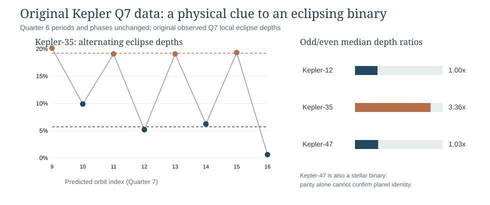

# Kepler Quarter 7 odd/even eclipse-depth diagnostic
**ASTR/PHSC 12600 | November 15, 2026 | Original NASA Kepler observations**

## Original proposal and why this check matters
The submitted November 5 proposal asks if AI can reproduce and evaluate established exoplanet identification methods using real NASA Kepler photometry and a simple Kepler candidate-classification model. An already completed BLS fit from **Quarter 6 only** was prospectively tested on Quarter 7 with fixed periods and phases. The original 12-target evidence is unchanged: **six of ten preselected planet-host systems passed**, both known binary controls passed, one target had no usable Quarter 7 observations, and the experiment predicted **dimming**, not a confirmed exoplanet.

A physically important failure was that Kepler-35 and Kepler-47, although both confirmed circumbinary planet hosts, passed through **eclipses of their stars**, not through the longer-period transits of the planets. The DR25 Robovetter literature (Thompson et al. 2018, Appendix A.4.1.4) and early false-positive tests (Batalha et al. 2010) describe **comparing odd and even eclipse depths** to recognize some stellar binaries whose two eclipses make a pipeline find half the true binary orbital period. We reanalyzed the original **145 Quarter 7 local event-depth measurements of eleven usable systems**. This is a retrospective physical test, not a new forecast or classification run.

Original NASA-derived successful run: [GitHub Actions 43512648584](https://github.com/DrewThomas09/ASTR_FInal_Project/actions/runs/43512648584), [frozen source artifact 14079785749](https://github.com/DrewThomas09/ASTR_FInal_Project/actions/runs/43512648584/artifacts/14079785749).
Unchanged source ZIP SHA-256: \`9eb71ebf72014a8392949923d95e2c9b3cc633047809e10bd0f67229dc558dac\`.

## What the preserved data show
The odd/even groups use each event's **original Quarter 6 predicted orbit index**, without optimizing any period or event center on Quarter 7. Depths are locally measured from original Q7 PDC-SAP stellar photometry.

| Known system | Q7 events even / odd | Median even depth (ppm) | Median odd depth (ppm) | Larger / smaller median |
|---|---:|---:|---:|---:|
| Kepler-12, known planet host | 10 / 10 | 15,669 | 15,657 | 1.00 |
| Kepler-35, known eclipsing binary + circumbinary planet | 4 / 4 | **57,207** | **192,062** | **3.36** |
| Kepler-47, known eclipsing binary + circumbinary planet | 5 / 5 | 126,345 | 130,092 | 1.03 |

All eight Kepler-35 events alternate between deeper and shallower eclipse classes. The earlier fitted BLS period was **10.371079 days**, approximately half the stellar binary orbital period of **20.7337 days**. Kepler-12's parity medians are nearly identical. **Kepler-47 shows the limit of the test:** it is also a stellar eclipsing binary, yet its two groups of observed local depths are similar. A missing odd/even difference does not imply a planet.

## The complete 11-source audit, including unfavorable cases
All analyzed Q7 event groups were examined (none excluded after seeing outcomes). The following p-values are exact two-sided event-rank comparisons, **exploratory** and conditional on an already selected set of known Kepler systems. They are not mission false-alarm probabilities or physical planet likelihoods.

| Source | Even / odd events | Even median (ppm) | Odd median (ppm) | Nominal exact p | Holm-adjusted p (11 sources) |
|---|---:|---:|---:|---:|---:|
| Kepler-10 | 25 / 24 | 96 | 66 | 0.2697 | 1.000 |
| Kepler-11 | 3 / 2 | 776 | 659 | 0.8000 | 1.000 |
| Kepler-12 | 10 / 10 | 15,669 | 15,657 | 0.6305 | 1.000 |
| Kepler-15 | 8 / 9 | 10,072 | 10,057 | 0.8148 | 1.000 |
| Kepler-19 | 5 / 4 | 641 | 592 | **0.0317** | 0.317 |
| Kepler-23 | 4 / 4 | 251 | 441 | 0.3429 | 1.000 |
| Kepler-26 | 3 / 4 | 2,223 | 2,665 | 0.4000 | 1.000 |
| Kepler-27 | 3 / 3 | 83 | -73 | 0.7000 | 1.000 |
| Kepler-30 | 3 / 3 | -54 | 63 | 1.0000 | 1.000 |
| Kepler-35 | 4 / 4 | **57,207** | **192,062** | **0.0286** | **0.314** |
| Kepler-47 | 5 / 5 | 126,345 | 130,092 | 1.0000 | 1.000 |

No odd/even rank comparison passed a 5% **Holm familywise correction** over all eleven stars. A nominal difference for **Kepler-19**, a known planet-host system, further demonstrates that even a low unadjusted p-value does not prove a stellar binary. These samples are small, consecutive events can be correlated, and their indices, durations and photometric windows were not optimized for the more sophisticated Kepler Robovetter odd/even test.

## Interpretation and next scientific experiment
Kepler-35 supplies an informative case where a **simple physical measurement reveals what a good timing prediction alone does not**. Kepler-47 and Kepler-19 show why that evidence cannot become a standalone planet-vs-binary classifier without a truly new held-out sample and multiple diagnostics. A stronger follow-up would freeze an odd/even screening rule on training stars, compare with secondary-eclipse and centroid diagnostics, and test previously unseen verified planet/binary sources at controlled false-positive and missed-candidate rates. **No such new model fit is claimed here.**

The research paper Version 11 includes the original-data two-panel figure, results, corrected figure references, and the professor's checklist. The companion ZIP contains the exact original successful NASA-derived archive, deterministic plotting Python, full 11-star CSV, numerical JSON, PNG and PDF figure, and clean-room reproduction instructions.

**Course synthesis:** Lesson 2 (received flux and blended light), Lesson 3 (event timing), Lessons 5-6 (binary and planetary orbital periods; Kepler's third law), Lab 1/Appendix B (accuracy versus precision).

**Scientific references:** Thompson et al. (2018), *Planetary Candidates Observed by Kepler VIII*, https://doi.org/10.3847/1538-4365/aab4f9; Batalha et al. (2010), *Pre-Spectroscopic False-Positive Elimination*, https://doi.org/10.1088/2041-8205/713/2/L103; Welsh et al. (2012), Kepler-35, https://doi.org/10.1038/nature10768; Orosz et al. (2012), Kepler-47, https://doi.org/10.1126/science.1228380.