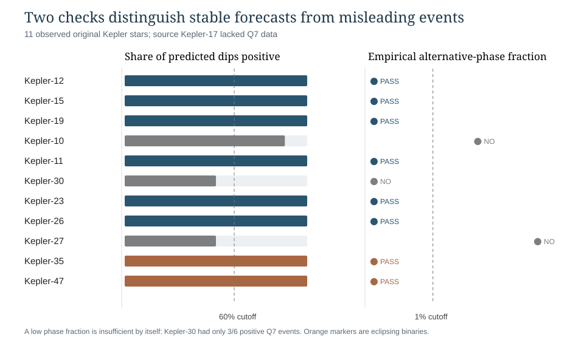

# Why a convincing Kepler phase match is not sufficient by itself
**ASTR/PHSC 12600 | 15 November 2026 | Supplemental quantitative check of the original frozen Kepler experiment**

## The original experiment was not changed

The November 8 predeclared Kepler Quarter 6-to-Quarter 7 protocol fitted Box Least Squares periods and epochs in Quarter 6 and evaluated the resulting unchanged forecasts against **actual, later Quarter 7 stellar flux observations**. [Successful November 13 original-data run](https://github.com/DrewThomas09/ASTR_FInal_Project/actions/runs/43512648584) and [frozen source artifact](https://github.com/DrewThomas09/ASTR_FInal_Project/actions/runs/43512648584/artifacts/14079785749) are available. The archive's SHA-256 is `9eb71ebf72014a8392949923d95e2c9b3cc633047809e10bd0f67229dc558dac`.

The frozen protocol required, for each usable star, **at least two adequately sampled predicted events**, **60% or more of predicted event windows with a positive local dip**, and a mean observed depth exceeding at least **99% of the 1,000 alternative phases** tested using the same star's Quarter 7 light curve. Those three criteria were not retuned. The sample was fixed at **ten known planet hosts and two known eclipsing-binary controls**; one host (Kepler-17) lacked Quarter 7 data. It comprised **145 usable predicted Q7 event windows across 11 observed stars** and **11,000 within-star alternative-phase comparisons**.

## One extra test: account for examining 11 stars

The previously archived original data already recorded one empirical phase-comparison fraction per observable star. To guard against overinterpreting eleven comparisons, we applied a **retrospective Holm correction** to those eleven recorded fractions, without fitting a new model, changing an event center or rewriting the original pass/fail criteria.

- **Nine of eleven** observable stars had the minimum phase fraction **1/1,001 = 0.000999**. Across eleven stars, their conservative Holm-adjusted fraction was **0.010989**, below 0.05. The phase comparisons for Kepler-10 and Kepler-27 were **0.057942** and **0.605395**, respectively.
- But **Kepler-30** was one of those nine with a low phase fraction: it still failed the original event-consistency rule because only **3/6** of its forecast windows had positive depths.
- Therefore the **original frozen two-part outcome remains eight of eleven observed stars passing**, including six of nine usable published planet hosts and both published eclipsing-binary controls (six of ten originally planned planet hosts, because one file was unavailable).

| Observation | Meaning |
|---|---|
| 9/11 phase fractions remain under 0.05 after Holm | The within-star phase signal is unusual compared with the chosen alternative phases in these observed systems, conditional on the validity of those empirical comparisons |
| 8/11 met the original combined rule | A low phase fraction **alone** does not show adequate recurrence |
| Both eclipsing-binary controls passed | Repeated dimming identifies a predictable **signal**, not necessarily a planet |
| The separate eleven-star *odd/even eclipse-depth* audit had no Holm-significant results | It is a **different test** of physical source identification and must not be confused with the phase-shift comparison |

**Important inferential limit:** the phase-shift fractions are empirical comparisons from deliberately selected, previously known Kepler systems, not calibrated planet-discovery probabilities or a general mission false-alarm estimate. The additional Holm calculation is **post hoc** and should not be described as part of the original predeclared selection rule. One thousand alternative phases also impose a minimum possible fraction of 1/1,001, so the exact evidence below that resolution cannot be distinguished.

## Reproducibility

The [short numeric verifier](v12_q6_q7_posthoc_phase_audit.py) checks the original frozen ZIP digest, each per-star phase fraction and positive event share, the original eight pass decisions, the full eleven-star Holm adjustment, and the Kepler-30 failure. The formatted **Version 12** Word/PDF manuscript has the revised Figure 4 and a shorter main argument (14 main figures versus the prior 19). The self-contained Version 12 research ZIP includes the **unchanged original source archive**, the full plot-producing Python script, per-star CSV, and JSON results. A clean extraction reproduced identical result JSON and PNG figure files.

## Class and scientific links

**Lesson 2:** flux and physical stellar eclipses; **Lesson 3:** timing fitted in one observation period and tested in a later one; **Lessons 5-6:** planet vs stellar-binary orbital periods; **Lab 1 / Appendix B:** precision, accuracy, uncertainty and why two independent measurements matter. Scientific background: Kovács, Zucker and Mazeh (2002), Box Least Squares, https://doi.org/10.1051/0004-6361:20020802; Thompson et al. (2018), Kepler DR25 Robovetter, https://doi.org/10.3847/1538-4365/aab4f9.