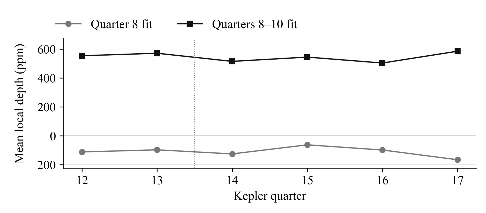
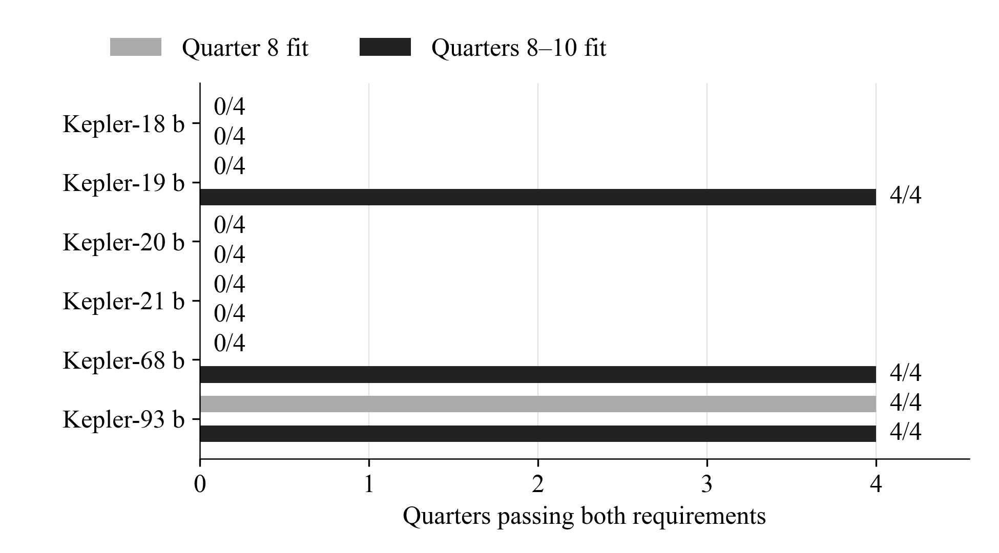

# Testing AI in Exoplanet Research

Drew Thomas | ASTR/PHSC 12600 | Professor Buzasi | Autumn 2026

## 1. Research question and physical background

Artificial intelligence can help write code, but a working program is only the beginning of a scientific investigation. I wanted to find out whether I could use AI to reproduce an established astronomy method, apply it to real measurements, and understand its mistakes. My original plan had two parts: search NASA Kepler observations for repeated dips in starlight, and compare a small machine-learning model with a simple rule for screening possible planets. Later, I added tests of future transit predictions and telescope movement.

An exoplanet is a planet orbiting a star other than the Sun. One way to find these planets is to measure a star's brightness over time. When a planet crosses in front of its star, it blocks some of the light. The resulting dip is called a transit. A graph of brightness against time is called a light curve. Repeated dips can reveal an orbital period, the time an object takes to complete one orbit.

This connects directly to Lesson 2's discussion of luminosity and flux. Luminosity describes how much energy a star gives off, while flux describes the light received per unit area. The telescope records changes in received light. Dividing each measurement by the usual brightness makes a small fractional change easier to compare. A decrease of 500 parts per million, or ppm, means a drop of 0.05%. A transit does not require the star itself to produce less light; part of its visible surface is temporarily blocked [1].

Lesson 3's discussion of time and recurring events explains why the spacing between dips matters. Lesson 6 adds the physical connection: for planets orbiting the same star, the square of the orbital period is approximately proportional to the cube of the orbit's size. A longer period usually means a larger orbit. These ideas explain why a repeating brightness pattern can be useful, but they do not prove that the object causing it is a planet [1].

Two stars can eclipse each other. Light from a nearby star can enter the same measurement. Instrument problems can also produce dips. Astronomers therefore need both a way to find patterns and ways to check their causes. I used Box Least Squares, or BLS, an established method that searches for short, repeated brightness decreases [2]. Work on Kepler's screening procedures showed why additional checks are necessary [3, 4]. Earlier machine-learning research and the more advanced ExoMiner system also showed that useful classification requires more information than one strong signal [5, 6].

My question became more specific as I worked: where could AI help me carry out these methods, and where would a convincing result still need further evidence? I treated the project as a small reproduction and evaluation of existing techniques. It did not aim to discover a new planet or replace NASA's analysis.

## 2. Building and checking the transit search

With AI assistance, I built Python programs around Astropy's BLS implementation [7]. The programs read Kepler light curves from the Mikulski Archive for Space Telescopes, remove unusable measurements, and search a range of possible periods [8]. I used NASA's processed brightness measurements, called PDCSAP flux, rather than starting from raw telescope images. I also divided the flux by a running median over 301 measurements to reduce slow changes in brightness. This can make a short dip easier to see, but it is another analysis choice that needs checking.

My first test used an artificial transit repeating every 3.25 days. The program recovered it, but the search covered only 2.8 to 3.8 days. That was a useful check that the code could run, yet it was an easy problem because the answer was already close to the center of the search range. I therefore moved to actual observations and kept track of cases where the program failed [10].

The first real target was the known planet Kepler-69 b. In Quarter 8, the cleaned data contained 2,767 brightness measurements spanning about 67 days. The search returned a period of 13.713342986 days, compared with the project's NASA reference value of 13.7223682 days [9, 10]. The relative difference was 0.06577009%. This showed that the program could recover a known repeating signal from real observations. Since the system was already known, it was a recovery test rather than a discovery.

I also added artificial dips to real stellar measurements. Only one of three signals with a depth of 500 ppm was recovered, while all three at 1,500 ppm and all three at 4,000 ppm were recovered. Recovery here meant finding a period within 2% of the inserted value, rather than passing a separate detection threshold. These small tests suggested that weak dips were harder to find. Three examples at each depth are far too few to estimate a general detection rate [10].

A broader test used six named planets and seven eclipsing binary systems. The first search matched the intended planet's period in only three of the six planet systems. Six binary systems had usable results, and the simple warning checks flagged none of them as binaries. Four produced a period close to half the published binary period. If both stars eclipse each other during one orbit, the program can interpret the two dips as separate repetitions of a shorter cycle [10].

Systems with several planets introduced another problem: the strongest signal could belong to a different planet from the one I intended to study. Repeating the search after removing a detected signal helped recover Kepler-20 b after the stronger Kepler-20 c signal. It still did not recover Kepler-18 b within three passes. This was a development follow-up chosen after examining the earlier failures, not an independent validation [10]. The next step was to ask whether a measured period could predict later dips, while keeping that question separate from identifying the object that caused them.

## 3. Improving transit predictions

A period can look accurate as a percentage and still lead to poor predictions months later. The difference between the original Kepler-69 b period and the reference period was about 779.8 seconds, or 13 minutes, per orbit. Multiplying that difference by 30 orbits gives about 6.50 hours. This calculation isolates the accumulated period discrepancy; a full prediction also depends on the fitted time of the first transit. It explains why a small numerical difference deserves attention.

The initial forecast kept the Quarter 8 fit fixed and looked for dips in later observations. All seven usable windows in Quarter 9 had positive measured depths, as did all six in Quarter 10. Five of six usable windows were positive in Quarter 11, but none of the six in Quarter 12 or the six in Quarter 13 were positive. A positive depth means that the measured brightness was lower inside the predicted window than in nearby measurements. The planet had not stopped transiting. The predictions had moved away from the dips. A later check using the reference period recovered positive dips in all six windows in each of Quarters 12 and 13, but that was an explanatory check using a known answer [10].

This is a practical example of the difference between precision and accuracy discussed in the laboratory material. Writing a period with many decimal places does not establish that it predicts events accurately. It also connects to uncertainty propagation. In a simplified two-transit estimate, the period equals the time between the first and last transit divided by the number of completed orbits. If the two time measurements have equal, independent errors, the uncertainty in their difference is the uncertainty of one time multiplied by the square root of two. Dividing by more completed orbits reduces the resulting period uncertainty. This illustration assumes the orbit count is correct; it is not an uncertainty estimate for my BLS fits [1].

I then compared the original Quarter 8 fit with a fit using Quarters 8, 9, and 10 together. Both searches covered 1.5 to 20 days and used the same BLS method. The longer fit used 11,172 measurements across 264.88 days. It returned a period of 13.722233693 days, only about 11.6 seconds per orbit from the project's reference value. The reference period was used to assess the result, not supplied as the fitted answer [13].

**Table 1. Kepler-69 b timing comparison.** The period differences are comparisons with a published reference, not confidence intervals. The later-window and phase-test results use Quarters 14–17 and the same 0.153-day window duration for both fits [13].

| Measure | Quarter 8 fit | Quarters 8–10 fit |
| --- | --- | --- |
| Brightness measurements | 2,767 | 11,172 |
| Observing interval | 66.96 days | 264.88 days |
| Estimated period | 13.713342986 days | 13.722233693 days |
| Difference from reference | 0.06577009% | 0.00098020% |
| Positive later windows | 5 of 19 | 19 of 19 |
| Later quarters passing phase test | 0 of 4 | 4 of 4 |

Quarters 12 and 13 had already been examined, so I kept them as development comparisons. Quarters 14 through 17 were newly evaluated in this project. The experiment plan was fixed before those evaluations. To prevent the new fit from receiving an advantage simply through a wider measurement window, the main comparison used the original 0.153-day window for both fits. Each model predicted 22 centers within the observed spans; 19 windows had enough nearby data to use [13].

A positive window by itself was not enough to pass. The fixed rule required at least two usable windows, positive depths in at least 60% of them, and a favorable comparison with 1,000 alternative positions in the repeating cycle. An adjusted comparison fraction, based on how often alternative phases did at least as well, had to be no greater than 0.01. This tests the chosen timing against other timings for the same star. It is not a false-alarm probability for the entire Kepler mission [13].

The new fit produced positive depths in all 19 usable windows and passed the rule in all four new quarters. The original fit had five positive windows and passed in none. Figure 1 shows the average local depth in each later quarter. Quarter 17 contained only two usable windows, and all the quarters belong to one previously known system. The result supports better timing for this case without establishing a general success rate.

**Figure 1. Mean depth at predicted transit times.** Positive depth means a decrease in brightness. Both fits use the same window duration. Quarters 12–13 were previously examined; Quarters 14–17 were newly evaluated. Points summarize usable windows within each quarter, without implying that the observations are independent or giving an uncertainty interval [13].

I repeated the comparison on the earlier sample of six other named planets and seven binary systems. A planet test counted as successful only if the fitted period was within 2% of the named planet's reference period and passed the phase rule. Across six planets and four later quarters, successes increased from 4 of 24 to 12 of 24. Kepler-19 b and Kepler-68 b improved from zero to four passing quarters each. Kepler-93 b passed all four with either fit. The other three named planets remained unsuccessful under the combined rule [14].

The binary controls help explain the limitation. Four of the seven planned binary systems supplied paired data, giving 15 of the 28 planned quarter comparisons. Their phase-test passes increased from 6 of 15 to 14 of 15. Better timing therefore helped predict stellar eclipses too. In Kepler-20, the refined fit passed the phase test but selected a period near 10.854 days, rather than Kepler-20 b's roughly 3.696-day period. A repeating signal still did not identify the intended planet [14].

The longer observing interval and the larger number of measurements changed together, so this comparison does not isolate their separate effects. The sample was small and deliberately selected from systems already studied. I kept failed and unavailable cases in the records. Published work on refining transit predictions gave context for the result, while later Kepler research shows that real transit times can also vary in ways a single average period does not capture [11, 12].

**Figure 2. Passing quarters for each named planet.** Each star has four paired evaluations. A pass requires both the intended planet's period and the phase criterion. These are repeated observations of six stars, not 24 independent planets [14].

## 4. Screening NASA catalog signals

The second main part of the project used NASA's Kepler Data Release 25 catalog. I compared a simple signal-to-noise rule with a random forest, a model that combines many decision trees. Both methods used existing catalog records. The forest used four NASA-derived measurements: period, transit duration, transit depth, and signal-to-noise ratio. It did not receive measurements from my separate BLS program [15].

The selected catalog contained 8,054 signals from 6,923 stars, labeled as either planet candidates or false positives. Signals belonging to the same star were kept together when separating the data into training, validation, and test groups. That matters because learning about a star in training could otherwise make a later test on the same star too easy. The final test contained 1,619 signals from 1,385 stars: 851 candidate-labeled signals and 768 false-positive-labeled signals [15].

I chose each method's decision threshold using the validation stars, with a target of retaining 90% of the candidate-labeled signals. The test stars were then evaluated separately. The target was a way to choose a threshold; it did not guarantee 90% recall on a new group. Here, recall means the fraction of candidate-labeled records the method kept.

The forest agreed with the historical labels much more often, but the result involved a trade-off. It accepted 506 fewer false-positive-labeled signals while rejecting 32 additional candidate-labeled signals. A stricter screen reduced the number of questionable signals to review, yet it also discarded more signals NASA had kept as possible planets. Reporting accuracy alone would hide that cost.

**Table 2. Screening results on the separate test stars.** Accuracy means agreement with NASA's historical screening labels. False-positive acceptance is the fraction of the 768 false-positive-labeled records that the method kept [15].

| Test result | Signal-to-noise rule | Random forest |
| --- | --- | --- |
| Agreement with historical labels | 52.32% | 81.59% |
| Candidate-label recall | 90.95% | 87.19% |
| False-positive acceptance | 90.49% | 24.61% |
| Candidate-labeled signals retained | 774 of 851 | 742 of 851 |
| False-positive-labeled signals retained | 695 of 768 | 189 of 768 |
| Candidate-labeled signals rejected | 77 of 851 | 109 of 851 |
| False-positive-labeled signals rejected | 73 of 768 | 579 of 768 |

Long-period candidates were a useful example. Of 71 candidate-labeled signals with periods of at least 100 days, the forest retained 44 and rejected 27. The rejected group had a median period of about 359 days and a median depth of 482 ppm, compared with 166 days and 915 ppm among retained candidates. This describes what was missed; it does not establish why each record was misclassified or whether it represents a real planet [16].

In a separate exploratory split, I tried a more permissive threshold for long-period signals. Candidate retention rose from 42 of 58 to 57 of 58, but accepted false positives also rose from 28 of 87 to 64 of 87. The change recovered more candidates at a substantial cost. These counts came from a different split and should not be combined with Table 2 [17].

NASA's candidate labels are screening decisions, not independent proof of planets. Professional systems use many more measurements and checks than this four-input model [4–6]. The experiment showed that AI-assisted coding could help reproduce a useful classification approach. It did not show that my model was better than NASA's systems or ready to validate new planets.

## 5. Testing pointing correction

An additional experiment considered which star caused a brightness dip. When two stars appear close together, their light can overlap. If one dims, the center of the combined light can move toward the other. This center is called the centroid. Telescope movement can also shift it, making the physical cause harder to interpret.

Using separate TESS observations, I subtracted a recorded pointing-motion estimate from the measured centroid. A measure of local movement became smaller in 44 of 56 stars and larger in 12. However, the follow-up checks did not show a reliable improvement in identifying the source of a dip [18]. The professional Kepler pipeline already includes corrections for instrument effects, so my experiment was a test of a simple adjustment rather than a new solution to an overlooked problem [19].

To understand how a correction might help or hurt, I used a controlled simulation with two stars one pixel apart. One star was four times brighter than the other. Either star could dim, but the total brightness decrease was the same in both cases. That left the direction of the centroid shift as the clue to which star had dimmed. The same 2,000 simulated events, with 1,000 from each source, were reused across twelve noise conditions [20].

When shared pointing movement was large and the reference measurement was precise, correct source identification increased from 52.30% to 83.15% after correction. When there was no shared pointing movement and the reference was noisy, accuracy fell from 83.95% to 59.15%. Subtracting the reference removed shared movement but added the reference's own measurement error [20].

Under the simulation's independent-error assumptions, the correction reduces the expected squared error only when the variance of the shared pointing movement exceeds the variance of the reference measurement. This follows from the laboratory rule that variances add when independent uncertain measurements are subtracted [1]. The simulation assumes perfectly shared movement and chosen noise levels. It offers one possible explanation for the TESS result, without proving its cause. A steadier measurement is useful only if it also helps answer the scientific question.

## 6. What the project shows

AI helped me turn an idea into programs that could read astronomy files, run established methods, and compare results. Its most useful role was practical: generating code, explaining errors, and helping organize repeated checks. The project also showed why each result needs a clear interpretation. An easy artificial example checked basic operation. A known planet checked recovery. Later observations checked prediction. Binary stars checked whether repeating dips alone could identify planets. Each test answered a different question.

The strongest improvement was in transit timing. For Kepler-69 b, fitting three earlier quarters reduced the discrepancy from the reference period from about 780 seconds to about 12 seconds per orbit. The refined prediction passed the fixed phase rule in all four newly evaluated quarters. Across the six other named planets, successful quarter comparisons increased from 4 of 24 to 12 of 24. The failures remained important: three intended planets still were not recovered, and the same timing method improved binary-eclipse predictions [13, 14].

The classifier provided a different kind of improvement. It removed many more historically labeled false positives than the simple rule, but it also missed more historical candidates. The pointing experiment provided a different warning: lowering visible motion did not establish better source identification. The simulation explained how a correction could add enough error to make a result worse.

These outcomes connect the project's coding work to the course's physical ideas. Flux measurements make small dips visible, recurring events allow periods to be measured, gravity gives those periods physical meaning, and uncertainty determines how far a prediction can be trusted. AI made the methods more accessible. Understanding the measurements, choosing fair comparisons, and keeping the unsuccessful results were necessary to explain what the programs had actually achieved.

## Acknowledgment

Generative AI assisted with code development, debugging, running the continuation experiments, and preparing explanations and figures. NASA and MAST provided the observational data. The linked repository contains the programs, experiment plans, and recorded results.

## References

[1] ASTR/PHSC 12600 course materials (2026). Lesson 2, luminosity and flux, pp. 40–42; Lesson 3, time and recurrence, pp. 60–65; Lesson 6, Kepler's third law and Newtonian gravity, pp. 5 and 30; Lab Manual Appendix B, accuracy, precision, and uncertainty propagation, pp. 3–4.

[2] Kovács, G., Zucker, S., and Mazeh, T. (2002). A box-fitting algorithm in the search for periodic transits. Astronomy & Astrophysics, 391, 369–377. [doi:10.1051/0004-6361:20020802](https://doi.org/10.1051/0004-6361:20020802).

[3] Batalha, N. M., et al. (2010). Pre-spectroscopic False-Positive Elimination of Kepler Planet Candidates. The Astrophysical Journal Letters, 713, L103–L108. [doi:10.1088/2041-8205/713/2/L103](https://doi.org/10.1088/2041-8205/713/2/L103).

[4] Thompson, S. E., et al. (2018). Planetary Candidates Observed by Kepler. VIII. A Fully Automated Catalog with Measured Completeness and Reliability Based on Data Release 25. The Astrophysical Journal Supplement Series, 235(2), 38. [doi:10.3847/1538-4365/aab4f9](https://doi.org/10.3847/1538-4365/aab4f9).

[5] McCauliff, S. D., et al. (2015). Automatic Classification of Kepler Planetary Transit Candidates. The Astrophysical Journal, 806(1), 6. [doi:10.1088/0004-637X/806/1/6](https://doi.org/10.1088/0004-637X/806/1/6).

[6] Valizadegan, H., et al. (2022). ExoMiner: A Highly Accurate and Explainable Deep Learning Classifier That Validates 301 New Exoplanets. The Astrophysical Journal, 926(2), 120. [doi:10.3847/1538-4357/ac4399](https://doi.org/10.3847/1538-4357/ac4399).

[7] Astropy Collaboration. [Box Least Squares (BLS) Periodogram](https://docs.astropy.org/en/stable/timeseries/bls.html). Astropy documentation.

[8] Space Telescope Science Institute. [Kepler mission data](https://archive.stsci.edu/missions-and-data/kepler). Mikulski Archive for Space Telescopes.

[9] NASA Exoplanet Archive. [Kepler-69 system overview](https://exoplanetarchive.ipac.caltech.edu/overview/Kepler-69). Reference period used in the archived project: 13.7223682 days.

[10] Thomas, D. (2026). ASTR exoplanet research records: [original Kepler and injection tests](https://github.com/DrewThomas09/ASTR_FInal_Project/blob/main/REAL_KEPLER_LIGHTCURVE_RESULTS_2026_11_06.md); [13-system validation](https://github.com/DrewThomas09/ASTR_FInal_Project/blob/main/FROZEN_REAL_13STAR_VALIDATION_RESULTS.md); [iterative planet searches](https://github.com/DrewThomas09/ASTR_FInal_Project/blob/main/ITERATIVE_BLS_REAL_MULTIPLANET_RESULTS.md); [original Kepler-69 b prediction results](https://github.com/DrewThomas09/ASTR_FInal_Project/blob/main/NOV18_PLAIN_ENGLISH_KEPLER69B_RESEARCH_RESULTS.md).

[11] Edwards, B., et al. (2021). Original Research by Young Twinkle Students (ORBYTS): ephemeris refinement of transiting exoplanets. Monthly Notices of the Royal Astronomical Society, 504(4), 5671–5684. [doi:10.1093/mnras/staa1245](https://doi.org/10.1093/mnras/staa1245).

[12] Lissauer, J. J., et al. (2024). Updated Catalog of Kepler Planet Candidates: Focus on Accuracy and Orbital Periods. The Planetary Science Journal, 5(6), 152. [doi:10.3847/PSJ/ad0e6e](https://doi.org/10.3847/PSJ/ad0e6e).

[13] Thomas, D. (2026). [Kepler-69 b timing refinement: verified results](https://github.com/DrewThomas09/ASTR_FInal_Project/blob/main/NOV25_MULTIQ_EPHEMERIS_VERIFIED_RESULTS.md). Experiment plan, input records, and complete comparison tables are linked in the report.

[14] Thomas, D. (2026). [13-system timing comparison: verified results](https://github.com/DrewThomas09/ASTR_FInal_Project/blob/main/NOV25_MULTIQ_COHORT_VERIFIED_RESULTS.md). Includes successful, unsuccessful, and unavailable cases.

[15] Thomas, D. (2026). [NASA DR25 classifier results](https://github.com/DrewThomas09/ASTR_FInal_Project/blob/main/REAL_NASA_DR25_RESULTS_2026_11_06.md). Held-out counts and screening metrics.

[16] Thomas, D. (2026). [Long-period error and cost analysis](https://github.com/DrewThomas09/ASTR_FInal_Project/blob/main/NOV13_KEPLER_LONG_PERIOD_ERROR_AND_COST_AUDIT.md).

[17] Thomas, D. (2026). [Exploratory period-aware threshold results](https://github.com/DrewThomas09/ASTR_FInal_Project/blob/main/VERIFIED_DR25_PERIOD_AWARE_THRESHOLD_NEGATIVE_2026_11_08.md).

[18] Thomas, D. (2026). [TESS centroid comparison across 56 stars](https://github.com/DrewThomas09/ASTR_FInal_Project/blob/main/VERIFIED_NOV12_TESS_56STAR_RAW_VS_POINTING_CORRECTED_CENTROID_ROBUSTNESS.md) and [source-identification follow-up](https://github.com/DrewThomas09/ASTR_FInal_Project/blob/main/VERIFIED_NOV13_FULL_RESULTS_WHAT_WORKED_WHAT_FAILED_NASA_TESS_PRF_BENCHMARK.md).

[19] NASA Kepler Science Office. [Kepler Data Characteristics Handbook](https://archive.stsci.edu/kepler/manuals/Data_Characteristics.pdf). Discussion of corrections for instrument effects.

[20] Thomas, D. (2026). [Controlled pointing simulation](https://github.com/DrewThomas09/ASTR_FInal_Project/blob/main/NOV25_CONTROLLED_POINTING_SIMULATION_RESULTS.md). Fixed experiment plan and results for twelve noise conditions.

---

# Project Elements Checklist Form

Drew Thomas | ASTR/PHSC 12600

Testing AI in Exoplanet Research

## Synthesis of Lecture Material

| Lecture Number/Topic | Concepts included in the Project | Location in the Project/Essay/Write-Up |
|---|---|---|
| Lesson 2 — Luminosity and flux | The difference between a star's emitted light and the light received at a telescope. Transit dips and the effect of nearby stars on measured brightness. | Sections 1, 2, and 5 |
| Lesson 3 — Time | Repeating events as a way to measure time. Predicting future transits and explaining how a small period error accumulates. | Sections 1 and 3 |
| Lesson 6 — Kepler's laws and Newtonian gravity (Optional Bonus) | Orbital periods and their connection to gravity. Why both planets and eclipsing stars can produce regular dimmings. | Sections 1, 2, and 3 |

## Quantitative analysis

### Briefly describe the quantitative analysis component of your project

I measured Kepler-69 b's period, compared it with the published value, and tested later transit predictions using fits from one and three quarters. I repeated the comparison on six other named planets and seven binary systems, retaining unsuccessful and unavailable cases. I compared a random forest with a signal-strength rule on 1,619 held-out NASA records. I also tested motion correction on 56 TESS stars and used 2,000 simulated events to compare source identification under twelve noise conditions.

### Where is the quantitative component(s) found, within your project, essay, and/or write-up?

Section 2 gives the recovered Kepler-69 b period and the tests on other systems. Section 3 contains the timing calculations, later-quarter predictions, and comparisons of fits using one and three quarters. Section 4 reports classification accuracy, candidate recall, and false-positive rates. Section 5 reports the real TESS motion comparison and the separately identified simulation. The supporting GitHub repository provides the code, experimental protocols, and recorded results.
